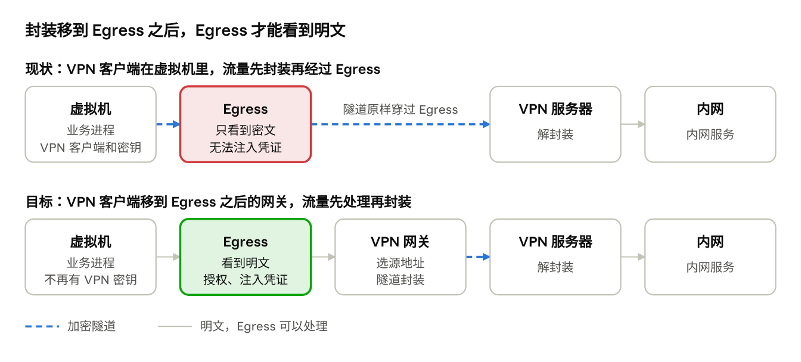

# Egress 与 VPN 共存方案

2026-11-20

把 VPN 客户端从虚拟机移到 Egress 之后的 VPN 网关：流量先由 Egress 做七层处理，再进入隧道，每台虚拟机的内网 IP 通过地址映射保留。本文是设计稿：网关的配置和 Egress 的上游片段已在本机用真实的 Envoy 模拟跑通，WireGuard 隧道和真实环境的端到端链路尚未验证。

## 背景与问题

虚拟机访问内网的流量在离开虚拟机之前就被 VPN 加密封装，Egress 只能看到密文，无法注入凭证。

- 所有虚拟机的出口流量经过共享的 Egress 服务。凭证、身份等非业务逻辑在 Egress 内实现，虚拟机内的恶意进程拿不到。
- 虚拟机还要通过 VPN 访问内网。每台虚拟机运行一个 WireGuard 客户端，各自与同一个 VPN 服务器建立隧道，并获得独立的内网 IP。
- 结果是二选一：走 VPN 就得不到 Egress 的保护，不走 VPN 就到不了内网。

VPN 密钥本身也是一种凭证。它放在虚拟机里，恶意进程同样拿得到，还能用它绕过 Egress 直连内网。

根源是封装的位置不对：应该先由 Egress 处理，再进隧道。

现状中，隧道从虚拟机一直延伸到 VPN 服务器，Egress 夹在隧道中间。目标是让隧道只存在于 VPN 网关与 VPN 服务器之间。

## 目标与约束

方案要同时满足四个目标，并受五项既定条件约束。

1. 去往内网的流量经过 Egress 的七层处理，与去往公网的流量一致。
2. 虚拟机内不保留任何凭证，包括 VPN 密钥。
3. 每台虚拟机在内网的独立 IP 保持不变。
4. 虚拟机数量增长不带来隧道数量的同步增长。

| 约束 | 结论 |
| --- | --- |
| VPN 对端 | 所有虚拟机连接同一个 VPN 服务器，服务器由我们自己运维 |
| VPN 协议 | WireGuard |
| 内网 IP | 每台虚拟机有独立的内网 IP，必须保留 |
| 规模 | 虚拟机数量增长很快 |
| Egress | 自己部署，多台虚拟机共享；实现应为 Envoy，待确认 |

## 方案选型

采用做法 C：一条站点到站点隧道，加一块由 VPN 服务器整体交给网关的地址。只有它既保留每台虚拟机的独立内网 IP，又不随虚拟机数量增加隧道。

三种做法都把 VPN 客户端移出虚拟机，区别在于隧道与虚拟机的对应关系。

|  | A 共用一条隧道 | B 每台虚拟机一条隧道 | C 一条隧道加地址块 |
| --- | --- | --- | --- |
| 做法 | 网关用一个身份拨号，所有虚拟机共用 | 网关上为每台虚拟机运行一个客户端 | 服务器把一段地址交给网关，网关按虚拟机选源地址 |
| 独立内网 IP | 没有 | 保留 | 保留 |
| VPN 服务器改动 | 不用 | 不用 | 增加一个 peer |
| 每增加一台虚拟机 | 无变化 | 多一个进程和一条隧道 | 多一条映射记录 |
| 结论 | 不满足内网 IP 约束 | 规模大时难以维护 | 采用 |

## 逻辑架构

数据路径自上而下分五层：虚拟机、Egress、VPN 网关、VPN 服务器、内网。地址分配表是控制面，向 Egress 下发授权策略，向网关下发映射记录。

虚拟机到 Egress、Egress 到网关都是明文连接，只有网关到 VPN 服务器这一段在隧道里。凭证只存在于 Egress，隧道密钥只存在于网关，两者都不在虚拟机里。

## 组件职责

方案涉及四个组件：地址分配表和 VPN 网关是新增的，Egress 和 VPN 服务器需要改造。

| 组件 | 职责 | 关键配置 |
| --- | --- | --- |
| 地址分配表（新增） | 虚拟机创建时分配内网 IP，销毁时回收；记录真实 IP、内网 IP 和允许访问的内网目的地 | 向 Egress 下发授权策略，向网关下发映射记录 |
| Egress（改造） | 识别来源虚拟机，检查授权，注入凭证；把去往内网的连接交给网关，并用 PROXY 协议头声明来源和目的地 | 新增指向网关的上游，开启 PROXY 协议 |
| VPN 网关 · Envoy（新增） | 只做四层转发：读取 PROXY 头，以头里声明的源地址向声明的目的地址发起连接 | `proxy_protocol`、`original_src`（标记 123）、`ORIGINAL_DST` 上游 |
| VPN 网关 · 内核（新增） | 把源地址从真实 IP 换成内网 IP；拦截未登记的虚拟机；把回程包交回本机的 Envoy | nftables 映射表 `vm2intra`，按标记的策略路由 |
| VPN 网关 · WireGuard（新增） | 持有隧道密钥，与 VPN 服务器建立一条站点到站点隧道 | 对端的 `AllowedIPs` 为内网网段 |
| VPN 服务器（改造） | 把整块地址交给网关；只接受源地址在地址块内的包 | 网关 peer 的 `AllowedIPs` 为地址块 |

全文使用以下示例地址：

| 含义 | 示例值 |
| --- | --- |
| 虚拟机真实网段 | `10.1.0.0/16` |
| 内网网段 | `10.200.0.0/16` |
| 网关单元 1 的内网地址块 | `100.64.0.0/22` |
| 网关监听地址 | `10.1.255.10:15001` |

完整配置见项目的 [`config/`](../config/) 目录：VPN 服务器一份，VPN 网关三份（WireGuard、Envoy、nftables），Egress 一份。

## 连接路径与地址变化

一条连接经过四段，源地址只在 VPN 网关处变一次：从虚拟机的真实 IP 换成它的内网 IP。下图以虚拟机 `10.1.2.3`（内网 IP `100.64.0.7`）访问内网服务 `10.200.5.6:443` 为例。

Egress 到网关这一段是一条新的连接，虚拟机的身份靠连接开头的 PROXY 头传递。回程不需要额外配置：网关内核按连接记录把目的地址还原，再按连接上的标记把包交给本机的 Envoy。这条路径已在本机用真实的 Envoy 模拟跑通，其中隧道一段用虚拟网卡代替。

## 安全设计

信任关系从“VPN 服务器逐台认证虚拟机”变为“VPN 服务器信任网关，网关信任 Egress，Egress 识别虚拟机”。这条链上每一环都要有对应的控制点。

| 控制点 | 要求 | 不落实的后果 |
| --- | --- | --- |
| 来源识别 | Egress 依赖虚拟化层保证的源 IP 或网卡识别虚拟机，并开启防地址欺骗 | 一台虚拟机可以冒用另一台的内网 IP |
| 网络隔离 | 虚拟机只能到达 Egress；网关的 15001 端口只对 Egress 实例开放 | 虚拟机直连网关，伪造 PROXY 头冒充任意虚拟机 |
| 授权 | “哪台虚拟机能访问内网的什么”在 Egress 上按来源控制 | 任何虚拟机都能访问内网的全部地址 |
| 未登记拦截 | 网关丢弃映射表里没有的来源；VPN 服务器丢弃地址块之外的源地址 | 未登记的虚拟机进入内网 |
| 旧密钥吊销 | 每迁移完一台虚拟机，就删除它在 VPN 服务器上的 peer | 虚拟机仍能绕过 Egress 直接拨号 |
| 网关加固 | 隧道密钥只存在于网关，网关按密钥托管设备的标准管理 | 网关被攻破等于整块地址被冒用 |

内网侧按 IP 配置的访问控制继续有效，因为每台虚拟机的内网 IP 没有变。

到内网服务使用 TLS 时，握手在 Egress 与内网服务之间端到端完成。网关只转发密文，看不到 Egress 注入的凭证。

## 高可用与扩容

容量按单元扩展：一对主备网关加若干地址块是一个单元。虚拟机增加只增加映射记录，单元满了再加一个单元。

- **主备切换**：主备两台网关使用同一对 WireGuard 密钥，同一时刻只启动一台。备机启动后发出第一个握手包，VPN 服务器会自动把对端地址更新为备机，服务器侧不用改配置。
- **切换的影响**：网关是有状态的，切换时已有连接会中断，业务需要重连。映射表要提前同步到备机。
- **Egress 扩容**：Egress 实例之间不需要为此共享状态，任何实例都可以把连接交给网关，可以独立扩容。
- **新增单元**：在 VPN 服务器上加一个 peer 和一个新地址块，在 Egress 上加一个指向新单元的上游。已有虚拟机不受影响。
- **Egress 选择单元**：虚拟机属于哪个单元由它的内网 IP 所在的地址块决定。虚拟机子网与单元对齐时，Egress 按源地址前缀就能选对单元；否则要按地址分配表逐台选择。
- **地址池规划**：地址池按几年后的规模一次留足，再按块分给各单元。事后扩大地址池比较麻烦。

WireGuard 按每个 peer 的 `AllowedIPs` 决定包发给谁，动态路由协议改变不了它。所以地址块直接写在 `AllowedIPs` 里，不使用 BGP 通告。

## 迁移步骤

新旧方式可以并存，逐台迁移，每一台都能单独回退。依据是 WireGuard 的 `AllowedIPs` 按最长前缀匹配：现有每台虚拟机一个 `/32` 的 peer，优先于网关的地址块。

1. 在 VPN 服务器上添加网关 peer，地址块覆盖现有虚拟机使用的内网地址段。此时所有虚拟机仍走各自的 `/32` peer，行为不变。
2. 部署 VPN 网关（WireGuard、Envoy、nftables），在 Egress 上加入指向网关的上游。
3. 选一台虚拟机：在映射表登记它的真实 IP 和现有内网 IP，停掉它的 VPN 客户端，把它去往内网的流量导向 Egress。
4. 在 VPN 服务器上删除这台虚拟机的 `/32` peer。它的地址落到网关 peer 上，旧密钥同时失效。
5. 验证通过后，按批重复第 3、4 步。

回退一台虚拟机：在 VPN 服务器上恢复它的 `/32` peer，重新启动它的 VPN 客户端，再从映射表删除它的记录。

## 验证情况

目前的验证都是本机模拟：网关的配置和 Egress 的上游片段已用真实的 Envoy 跑通，WireGuard 隧道和真实环境的链路还没有验证过。

| 部分 | 状态 | 说明 |
| --- | --- | --- |
| 网关的 nftables 规则和策略路由 | 已模拟验证 | 已登记的虚拟机以内网 IP 出现并能收到回程数据，未登记的被拦截，登记后立即连通 |
| 网关的 Envoy 配置 | 已模拟验证 | 用 Envoy 1.40.2 原样加载运行：能读取 PROXY 头，以虚拟机地址为源，连到头里声明的内网服务 |
| Egress 的上游片段 | 已模拟验证，前提待确认 | 接在一个参考 Egress 上运行，四层代理和七层代理两种接法都通过；两台虚拟机交替请求时来源不串。参考 Egress 是按透明劫持的假设写的，不是真实的 Egress |
| WireGuard 配置 | 未验证 | 没有实际建过隧道，模拟中用一对虚拟网卡代替 |
| 真实环境的端到端链路 | 未验证 | 包括真实的 Egress、TLS、主备切换和性能，需要测试环境 |

模拟在本机的网络命名空间里进行，搭出虚拟机、Egress、网关、内网服务四个节点。脚本是项目里的 [`test/envoy-chain.sh`](../test/envoy-chain.sh)（整条链路，需要 Envoy）和 [`test/gateway-kernel-path.sh`](../test/gateway-kernel-path.sh)（只测网关的内核路径，不需要 Envoy）。

模拟环境中，网关和 Egress 上运行的是真实的 Envoy 1.40.2。网关原样加载本方案的 Envoy 和 nftables 配置，Egress 使用本方案的上游片段。WireGuard 隧道用一对虚拟网卡代替；Egress 的监听器是按透明劫持的假设写的参考实现，分四层代理和七层代理两种接法。七项检查全部通过：

| 检查项 | Egress 接法 | 结果 |
| --- | --- | --- |
| 已登记的虚拟机访问内网服务 | 四层代理 | 通过，内网看到的来源是它的内网 IP |
| 已登记的虚拟机访问内网服务 | 七层代理 | 通过，内网看到的来源是它的内网 IP |
| 未登记的虚拟机访问内网服务 | 四层代理 | 通过，被拦截，连接被关闭 |
| 未登记的虚拟机访问内网服务 | 七层代理 | 通过，被拦截，返回 503 |
| 登记后再次访问 | 四层代理 | 通过，立即连通 |
| 登记后再次访问 | 七层代理 | 通过，立即连通 |
| 两台虚拟机交替发起 HTTP 请求 | 七层代理 | 通过，内网看到的来源不串 |

测试确认了设计里最关键的两点：网关能按 PROXY 头里的目的地址连到内网服务；Egress 复用上游连接时，不会把一台虚拟机的请求放到为另一台虚拟机建立的连接上。网关的配置原样通过，Egress 的上游片段只把网关域名换成了测试地址。

上线前在测试环境逐项确认。

已在本机模拟中通过，需要在真实环境复核。前三项决定方案能否成立：

- [ ] 网关能按 PROXY 头里的目的地址连到内网服务
- [ ] 内网服务看到的源地址是该虚拟机的内网 IP
- [ ] 内网的回程包能回到网关的 Envoy，连接能正常收发数据
- [ ] 映射表里未登记的虚拟机无法进入隧道

尚未测试：

- [ ] `/32` peer 与网关地址块并存时，未迁移的虚拟机仍走原隧道
- [ ] 删除一台虚拟机的 `/32` peer 后，它的流量改走网关，内网 IP 不变
- [ ] 主备切换后新连接能建立
- [ ] 到内网服务使用 TLS 时，在网关上抓包只能看到密文

## 前提、待确认事项与已知限制

方案成立的前提是 Egress 以透明方式劫持流量。这一点和下面三个问题需要向维护 Egress 的同事确认。模拟测试里的 Egress 是按这个前提写的参考实现，测试通过不能证明前提成立。

透明劫持指虚拟机直接向内网服务的 IP 发起连接，Egress 还原出原始目的地址。这样 PROXY 头里的目的地址才是真正的内网服务，网关才知道该连谁。

如果 Egress 是显式代理，或者按域名选上游，Egress 到网关要改用 HTTP CONNECT 传递目的地，内网域名要在网关侧解析，两份 Envoy 配置都要重写。

待确认：

- [ ] Egress 确实基于 Envoy
- [ ] Egress 的劫持方式是透明劫持，还是显式代理
- [ ] Egress 当前依靠什么识别来源虚拟机
- [ ] Egress 使用的 Envoy 版本，模拟测试用的是 1.40.2

已知限制：

- **只覆盖 TCP。** Egress 到网关用的是代理方式。UDP 等流量要进内网，需要在网关上另做一对一的地址转换，Egress 对这部分只能做四层控制。
- **不覆盖内网主动访问虚拟机。** 需要时可以在网关上做一对一的目的地址转换，但这部分流量不经过 Egress 的七层处理，要单独决定放行哪些端口。
- **网关切换会中断连接。** 网关保存着连接状态，主备切换后已有连接需要重建。
