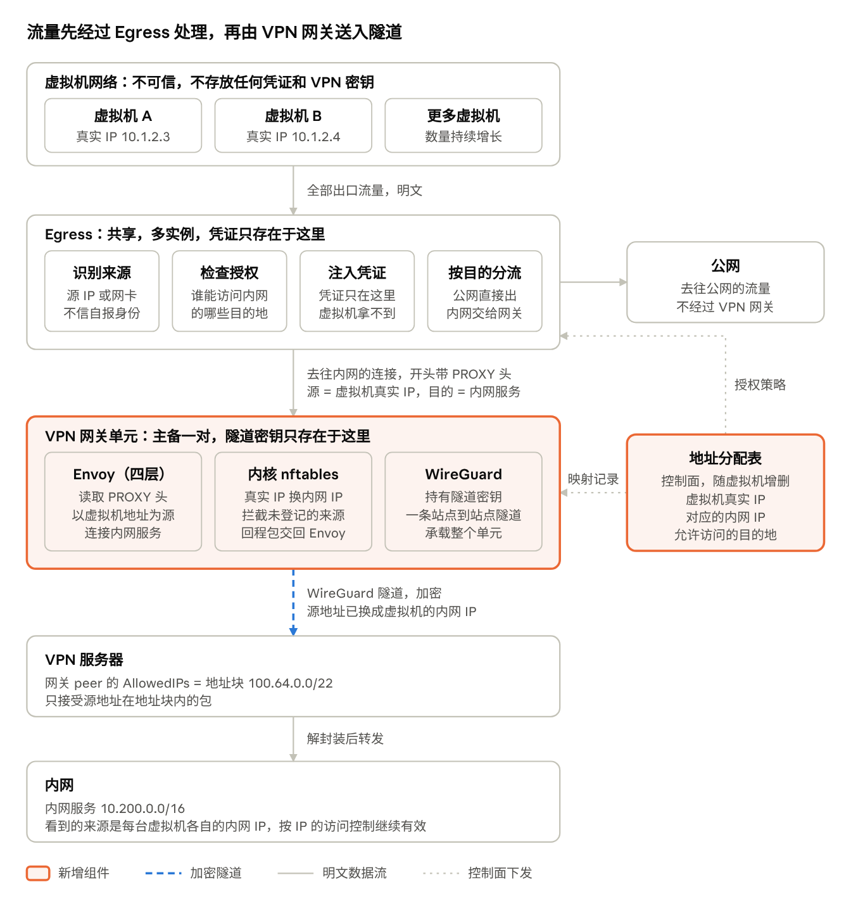
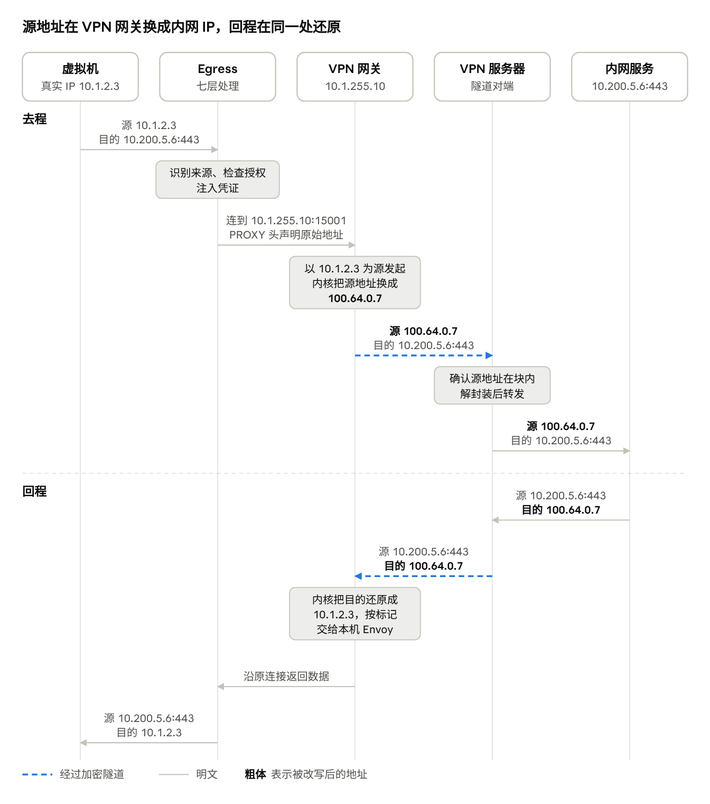

# Egress 与 VPN 共存方案

2026-11-20

把 VPN 客户端从虚拟机移到 Egress 之后的 VPN 网关：流量先由 Egress 做七层处理，再进入隧道，每台虚拟机的内网 IP 通过地址映射保留。整套方案已在 EVE-NG 实验环境里用真实的 WireGuard 和 Envoy 跑通，包括迁移、回退、TLS 和主备切换。实验里的 Egress 是参考实现，真实的 Egress 和生产环境尚未验证。

## 背景与问题

虚拟机访问内网的流量在离开虚拟机之前就被 VPN 加密封装，Egress 只能看到密文，无法注入凭证。

- 所有虚拟机的出口流量经过共享的 Egress 服务。凭证、身份等非业务逻辑在 Egress 内实现，虚拟机内的恶意进程拿不到。
- 虚拟机还要通过 VPN 访问内网。每台虚拟机运行一个 WireGuard 客户端，各自与同一个 VPN 服务器建立隧道，并获得独立的内网 IP。
- 结果是二选一：走 VPN 就得不到 Egress 的保护，不走 VPN 就到不了内网。

VPN 密钥本身也是一种凭证。它放在虚拟机里，恶意进程同样拿得到，还能用它绕过 Egress 直连内网。

根源是封装的位置不对：应该先由 Egress 处理，再进隧道。

现状中，隧道从虚拟机一直延伸到 VPN 服务器，Egress 夹在隧道中间。目标是让隧道只存在于 VPN 网关与 VPN 服务器之间。

## 目标与约束

方案要同时满足四个目标，并受五项既定条件约束。

1. 去往内网的流量经过 Egress 的七层处理，与去往公网的流量一致。
2. 虚拟机内不保留任何凭证，包括 VPN 密钥。
3. 每台虚拟机在内网的独立 IP 保持不变。
4. 虚拟机数量增长不带来隧道数量的同步增长。

| 约束 | 结论 |
| --- | --- |
| VPN 对端 | 所有虚拟机连接同一个 VPN 服务器，服务器由我们自己运维 |
| VPN 协议 | WireGuard |
| 内网 IP | 每台虚拟机有独立的内网 IP，必须保留 |
| 规模 | 虚拟机数量增长很快 |
| Egress | 自己部署，多台虚拟机共享；实现应为 Envoy，待确认 |

## 方案选型

采用做法 C：一条站点到站点隧道，加一块由 VPN 服务器整体交给网关的地址。只有它既保留每台虚拟机的独立内网 IP，又不随虚拟机数量增加隧道。

三种做法都把 VPN 客户端移出虚拟机，区别在于隧道与虚拟机的对应关系。

|  | A 共用一条隧道 | B 每台虚拟机一条隧道 | C 一条隧道加地址块 |
| --- | --- | --- | --- |
| 做法 | 网关用一个身份拨号，所有虚拟机共用 | 网关上为每台虚拟机运行一个客户端 | 服务器把一段地址交给网关，网关按虚拟机选源地址 |
| 独立内网 IP | 没有 | 保留 | 保留 |
| VPN 服务器改动 | 不用 | 不用 | 增加一个 peer |
| 每增加一台虚拟机 | 无变化 | 多一个进程和一条隧道 | 多一条映射记录 |
| 结论 | 不满足内网 IP 约束 | 规模大时难以维护 | 采用 |

## 逻辑架构

数据路径自上而下分五层：虚拟机、Egress、VPN 网关、VPN 服务器、内网。地址分配表是控制面，向 Egress 下发授权策略，向网关下发映射记录。

虚拟机到 Egress、Egress 到网关都是明文连接，只有网关到 VPN 服务器这一段在隧道里。凭证只存在于 Egress，隧道密钥只存在于网关，两者都不在虚拟机里。

## 组件职责

方案涉及四个组件：地址分配表和 VPN 网关是新增的，Egress 和 VPN 服务器需要改造。

| 组件 | 职责 | 关键配置 |
| --- | --- | --- |
| 地址分配表（新增） | 虚拟机创建时分配内网 IP，销毁时回收；记录真实 IP、内网 IP 和允许访问的内网目的地 | 向 Egress 下发授权策略，向网关下发映射记录 |
| Egress（改造） | 识别来源虚拟机，检查授权，注入凭证；把去往内网的连接交给网关，并用 PROXY 协议头声明来源和目的地 | 新增指向网关的上游，开启 PROXY 协议 |
| VPN 网关 · Envoy（新增） | 只做四层转发：读取 PROXY 头，以头里声明的源地址向声明的目的地址发起连接 | `proxy_protocol`、`original_src`（标记 123）、`ORIGINAL_DST` 上游 |
| VPN 网关 · 内核（新增） | 把源地址从真实 IP 换成内网 IP；拦截未登记的虚拟机；把回程包交回本机的 Envoy | nftables 映射表 `vm2intra`，按标记的策略路由 |
| VPN 网关 · WireGuard（新增） | 持有隧道密钥，与 VPN 服务器建立一条站点到站点隧道 | 对端的 `AllowedIPs` 为内网网段 |
| VPN 服务器（改造） | 把整块地址交给网关；只接受源地址在地址块内的包 | 网关 peer 的 `AllowedIPs` 为地址块 |

全文使用以下示例地址：

| 含义 | 示例值 |
| --- | --- |
| 虚拟机真实网段 | `10.1.0.0/16` |
| 内网网段 | `10.200.0.0/16` |
| 网关单元 1 的内网地址块 | `100.64.0.0/22` |
| 网关监听地址 | `10.1.255.10:15001` |

完整配置见项目的 [`config/`](../config/) 目录：VPN 服务器一份，VPN 网关三份（WireGuard、Envoy、nftables），Egress 一份。

## 连接路径与地址变化

一条连接经过四段，源地址只在 VPN 网关处变一次：从虚拟机的真实 IP 换成它的内网 IP。下图以虚拟机 `10.1.2.3`（内网 IP `100.64.0.7`）访问内网服务 `10.200.5.6:443` 为例。

Egress 到网关这一段是一条新的连接，虚拟机的身份靠连接开头的 PROXY 头传递。回程不需要额外配置：网关内核按连接记录把目的地址还原，再按连接上的标记把包交给本机的 Envoy。这条路径已在 EVE-NG 实验里用真实的 WireGuard 和 Envoy 跑通。

## 安全设计

信任关系从“VPN 服务器逐台认证虚拟机”变为“VPN 服务器信任网关，网关信任 Egress，Egress 识别虚拟机”。这条链上每一环都要有对应的控制点。

| 控制点 | 要求 | 不落实的后果 |
| --- | --- | --- |
| 来源识别 | Egress 依赖虚拟化层保证的源 IP 或网卡识别虚拟机，并开启防地址欺骗 | 一台虚拟机可以冒用另一台的内网 IP |
| 网络隔离 | 虚拟机只能到达 Egress；网关的 15001 端口只对 Egress 实例开放 | 虚拟机直连网关，伪造 PROXY 头冒充任意虚拟机 |
| 授权 | “哪台虚拟机能访问内网的什么”在 Egress 上按来源控制 | 任何虚拟机都能访问内网的全部地址 |
| 未登记拦截 | 网关丢弃映射表里没有的来源；VPN 服务器丢弃地址块之外的源地址 | 未登记的虚拟机进入内网 |
| 旧密钥吊销 | 每迁移完一台虚拟机，就删除它在 VPN 服务器上的 peer | 虚拟机仍能绕过 Egress 直接拨号 |
| 网关加固 | 隧道密钥只存在于网关，网关按密钥托管设备的标准管理 | 网关被攻破等于整块地址被冒用 |
| Egress 拒绝访问网关网段 | Egress 拒绝虚拟机访问网关所在的网段，在劫持之前就丢弃。这一条是 EVE-NG 实验中发现的 | 虚拟机让 Egress 把自带伪造 PROXY 头的连接转给网关，冒充任意已登记的虚拟机。实验的对照测试证实了这一点 |

内网侧按 IP 配置的访问控制继续有效，因为每台虚拟机的内网 IP 没有变。

到内网服务使用 TLS 时，握手在 Egress 与内网服务之间端到端完成。网关只转发密文，看不到 Egress 注入的凭证。

### 凭证不落到虚拟机

目标是虚拟机拿不到凭证：虚拟机被攻破后，攻击者仍可以经 Egress 使用凭证，但带不走，也不能在别处使用。要做到这一点，凭证只放在 Egress 还不够，它可能回到虚拟机的每条途径都要有对应的控制点。

| 凭证回到虚拟机的途径 | 控制点 | 不落实的后果 |
| --- | --- | --- |
| 虚拟机让 Egress 把凭证发给自己控制的站点 | 只对指定的服务注入，目的地址、端口、Host 都要匹配；使用 TLS 时先验证对方证书 | 向任意站点发一个请求，对方就收到凭证。实验的对照测试证实了这一点 |
| 服务在响应里把凭证带回来（调试接口、错误页、TRACE 方法） | 凭证改用客户端证书或请求签名，秘密本身不在线路上传输；Egress 拒绝 TRACE | 使用令牌时，服务一旦回显请求头，令牌就回到虚拟机。Egress 管不住服务端的行为 |
| 在链路上抓到凭证 | Egress 向服务发起 TLS | 凭证在 Egress 之后的每一跳上以明文可见 |
| 从 Egress 的管理面读到凭证 | 虚拟机到不了 Egress 的管理接口和配置；不开 Envoy 的管理接口，它能导出含凭证的完整配置 | 凭证被整批读走 |
| 虚拟机自带一个凭证头 | Egress 覆盖或删除虚拟机带来的同名请求头 | 虚拟机可以拿别处得到的凭证冒充其他调用方 |
| 凭证泄露后被带到别处使用 | 服务端按来源地址限定：这份凭证只接受从这台虚拟机的内网 IP 发来 | 泄露的令牌从别的虚拟机、从内网里别的主机都能用。实验的对照测试证实了这一点 |

内网服务认的凭证三类都有：客户端证书、令牌、静态凭证。能做到的程度按类型不同，只有客户端证书能做到虚拟机拿不到；另外两类做不到，只能做到泄露了在别处用不了。

| 凭证类型 | 能做到的程度 | 要落实的事 |
| --- | --- | --- |
| 客户端证书（mTLS）或请求签名 | 虚拟机拿不到。私钥留在 Egress，线路上不出现秘密本身，服务想回显也回显不出来 | 由 Egress 向服务发起 TLS。服务不走 HTTP 也可以：Egress 不用看懂协议，在四层替虚拟机握手、出示它的证书 |
| 令牌 | 虚拟机从 Egress 拿不到，但服务一旦回显请求就会把它带回来 | 服务端按来源地址限定；令牌按虚拟机、按服务区分；尽量用短期令牌 |
| 静态凭证（账号口令、固定密钥），走 HTTP | 同令牌，而且不过期。多台虚拟机共用一个账号时，泄露后没法只作废其中一台 | 同令牌；能拆成每台一个账号的拆开。轮换只改 Egress 和服务两处，虚拟机不用动 |
| 静态凭证，不走 HTTP（数据库、缓存的口令） | Egress 注入不了，口令只能留在虚拟机里 | 列为例外逐个登记；服务端按来源地址限定；能改成客户端证书的优先改 |

对令牌和静态凭证，最有用的一条是**服务端按来源地址限定**。虚拟机拿回自己的凭证没有额外用处，它本来就能经 Egress 使用；危险在于凭证被带到别处使用，来源限定堵的正是这一点。本方案保留了每台虚拟机独立的内网 IP，所以服务端能限定到单台虚拟机。多台共用的账号只能限定到网关的地址块。

不走 HTTP 的口令注入不了，原因在本方案传递身份的方式。虚拟机的身份靠每条连接开头的 PROXY 头带给网关，这要求 Egress 给虚拟机的每条连接单独建一条上游连接。能替客户端登录的协议代理（例如 Envoy 的 Redis 代理）使用自己维护的上游连接，不对应某一条虚拟机的连接，PROXY 头里没有虚拟机的地址，网关不知道该替谁、连到哪里。实验里这样配置后，请求在网关处被拒绝。Envoy 自带的 MySQL、PostgreSQL 过滤器只解析协议，没有代为登录的功能（据官方文档，未在实验里验证）。

凭证按虚拟机区分之后，Egress 上有“虚拟机到凭证”的对应关系，网关上有“虚拟机到内网 IP”的映射，两者都以虚拟机的地址为键，新增和下线虚拟机时要一起维护。

在 Egress 上摘掉一台虚拟机的凭证立刻生效，不需要轮换凭证。这以凭证没有泄露过为前提：令牌如果已经被服务回显带回过虚拟机，还要在服务端作废它；共用的静态凭证没法只作废一台，只能轮换。客户端证书没有这个问题。

这些控制点都在 Egress 和服务两端，VPN 网关、隧道和 VPN 服务器不需要改动：网关只做四层转发，不解析请求内容。

三个限制：

- **拿不到不等于用不了。** 虚拟机被攻破后，攻击者仍能让 Egress 替它带上凭证去访问。所以服务端要按身份授权，Egress 上要留审计记录。
- **需要凭证的访问必须让 Egress 能处理。** 虚拟机不能自己和服务做端到端的 TLS，否则 Egress 无法注入，凭证又得放回虚拟机。
- **服务接受凭证的每个入口都要被 Egress 覆盖。** 同一个服务如果还有 Egress 不做七层处理的端口，虚拟机可以在那里自带凭证，Egress 的覆盖和删除不起作用，泄露的凭证就有了用处。这类端口要么纳入七层处理，要么在 Egress 上拦掉。

两类凭证的做法后续要调整。方向是 2026-11-22 参考业界的做法选定的，还没有验证，在验证之前本文其余部分描述的仍是现在的做法：

- **客户端证书。** 每台虚拟机一张证书扩展不到几万台。改成 Egress 只用自己的一张证书，每个请求再带一份 Egress 签名的短期身份声明，写明是替哪台虚拟机发的，由服务或服务前面的校验代理核对。声明几分钟后过期，没有 Egress 的证书也用不了，所以这个做法同样适用于现在用令牌的服务。
- **不走 HTTP 的口令。** 不再留在虚拟机里，放到内网一侧、数据库前面的接入代理上。连接到它那里时来源已经是这台虚拟机的内网 IP，它按来源认出虚拟机，替它登录。

细节见[高可用与规模化方案](ha-scale-design.md)第 10 节，和业界做法的逐项对照见[和业界做法的对照](industry-comparison.md)。

## 高可用与扩容

容量按单元扩展：一对主备网关加若干地址块是一个单元。虚拟机增加只增加映射记录，单元满了再加一个单元。

- **主备切换**：主备两台网关使用同一对 WireGuard 密钥，同一时刻只启动一台。备机启动后发出第一个握手包，VPN 服务器会自动把对端地址更新为备机，服务器侧不用改配置。
- **切换的影响**：网关是有状态的，切换时已有连接会中断，业务需要重连。映射表要提前同步到备机。
- **Egress 扩容**：Egress 实例之间不需要为此共享状态，任何实例都可以把连接交给网关，可以独立扩容。
- **新增单元**：在 VPN 服务器上加一个 peer 和一个新地址块，在 Egress 上加一个指向新单元的上游。已有虚拟机不受影响。
- **Egress 选择单元**：虚拟机属于哪个单元由它的内网 IP 所在的地址块决定。虚拟机子网与单元对齐时，Egress 按源地址前缀就能选对单元；否则要按地址分配表逐台选择。
- **地址池规划**：地址池按几年后的规模一次留足，再按块分给各单元。事后扩大地址池比较麻烦。

EVE-NG 实验里的做法是用 keepalived 在两台网关之间漂移服务地址，当上主用时启动隧道，其余情况停掉隧道。实测主用网关断电后约 3.8 到 3.9 秒恢复，正常切换约 1.4 秒；重新上线的网关保持备用，不抢回主用。

keepalived 停止时一定要同时停掉这台网关的隧道，否则它会和新的主用抢 VPN 服务器的对端地址。实验里遇到过一次 keepalived 自己的停止通知没有执行，隧道留在了原来的网关上，中断持续了约 20 秒。现在由 systemd 在 keepalived 停止后再停一次隧道。

WireGuard 按每个 peer 的 `AllowedIPs` 决定包发给谁，动态路由协议改变不了它。所以地址块直接写在 `AllowedIPs` 里，不使用 BGP 通告。

## 迁移步骤

新旧方式可以并存，逐台迁移，每一台都能单独回退。依据是 WireGuard 的 `AllowedIPs` 按最长前缀匹配：现有每台虚拟机一个 `/32` 的 peer，优先于网关的地址块。

1. 在 VPN 服务器上添加网关 peer，地址块覆盖现有虚拟机使用的内网地址段。此时所有虚拟机仍走各自的 `/32` peer，行为不变。
2. 部署 VPN 网关（WireGuard、Envoy、nftables），在 Egress 上加入指向网关的上游。
3. 选一台虚拟机：在映射表登记它的真实 IP 和现有内网 IP，停掉它的 VPN 客户端，把它去往内网的流量导向 Egress。
4. 在 VPN 服务器上删除这台虚拟机的 `/32` peer。它的地址落到网关 peer 上，旧密钥同时失效。
5. 验证通过后，按批重复第 3、4 步。

回退一台虚拟机：在 VPN 服务器上恢复它的 `/32` peer，重新启动它的 VPN 客户端，再从映射表删除它的记录。

## 验证情况

方案已在两个层次上验证：本机的网络命名空间模拟，以及 EVE-NG 实验环境里九台节点的完整复现。两处的 Egress 都是按透明劫持假设写的参考实现，真实的 Egress 和生产环境还没有验证。

| 部分 | 状态 | 说明 |
| --- | --- | --- |
| 网关的 nftables 规则和策略路由 | 已在实验环境验证 | 原样加载；已登记的虚拟机以内网 IP 出现并能收到回程数据，未登记的被拦截，登记后立即连通 |
| 网关的 Envoy 配置 | 已在实验环境验证 | 用 Envoy 1.40.2 原样加载运行：能读取 PROXY 头，以虚拟机地址为源，连到头里声明的内网服务 |
| WireGuard 配置 | 已在实验环境验证 | 真实隧道；`/32` 与地址块并存、删除 peer 后旧密钥失效、主备共用密钥切换都已实测 |
| Egress 的上游片段 | 已在实验环境验证，前提待确认 | 接在参考 Egress 上运行，四层、七层和 TLS 三种接法都通过。参考 Egress 是按透明劫持的假设写的，不是真实的 Egress |
| 真实的 Egress 与生产环境 | 未验证 | 包括真实 Egress 的劫持方式和 Envoy 版本、性能和容量 |

模拟在本机的网络命名空间里进行，搭出虚拟机、Egress、网关、内网服务四个节点。脚本是项目里的 [`test/envoy-chain.sh`](../test/envoy-chain.sh)（整条链路，需要 Envoy）和 [`test/gateway-kernel-path.sh`](../test/gateway-kernel-path.sh)（只测网关的内核路径，不需要 Envoy）。

模拟环境中，网关和 Egress 上运行的是真实的 Envoy 1.40.2。网关原样加载本方案的 Envoy 和 nftables 配置，Egress 使用本方案的上游片段。WireGuard 隧道用一对虚拟网卡代替；Egress 的监听器是按透明劫持的假设写的参考实现，分四层代理和七层代理两种接法。七项检查全部通过：

| 检查项 | Egress 接法 | 结果 |
| --- | --- | --- |
| 已登记的虚拟机访问内网服务 | 四层代理 | 通过，内网看到的来源是它的内网 IP |
| 已登记的虚拟机访问内网服务 | 七层代理 | 通过，内网看到的来源是它的内网 IP |
| 未登记的虚拟机访问内网服务 | 四层代理 | 通过，被拦截，连接被关闭 |
| 未登记的虚拟机访问内网服务 | 七层代理 | 通过，被拦截，返回 503 |
| 登记后再次访问 | 四层代理 | 通过，立即连通 |
| 登记后再次访问 | 七层代理 | 通过，立即连通 |
| 两台虚拟机交替发起 HTTP 请求 | 七层代理 | 通过，内网看到的来源不串 |

测试确认了设计里最关键的两点：网关能按 PROXY 头里的目的地址连到内网服务；Egress 复用上游连接时，不会把一台虚拟机的请求放到为另一台虚拟机建立的连接上。网关的配置原样通过，Egress 的上游片段只把网关域名换成了测试地址。

### EVE-NG 实验环境的完整复现

2026-11-20 在 EVE-NG 里用九台 Linux 节点复现了整个场景：三台业务虚拟机、Egress、主备两台 VPN 网关、VPN 服务器、内网服务和一个模拟公网站点。WireGuard 和 Envoy 都是真实的，网关和 VPN 服务器使用本方案的配置。

| 阶段 | 检查项数 | 结果 |
| --- | --- | --- |
| 复现现状 | 10 | 全部通过 |
| 部署新方案，不迁移 | 6 | 全部通过，虚拟机的行为不变 |
| 逐项验证 | 29 | 全部通过 |
| 主备切换 | 21 | 全部通过，连续跑了两遍 |
| 凭证不落到虚拟机 | 40，另有 3 项对照 | 全部通过，3 项对照都成立 |
| 按凭证类型：令牌、静态凭证、不走 HTTP 的服务 | 34，另有 5 项对照 | 全部通过，5 项对照都成立 |

实验确认的结论：

- **现状的问题可以复现。** 虚拟机自带隧道时，Egress 在虚拟机网卡上只抓到 WireGuard 的 UDP，去内网的请求里没有凭证。
- **迁移后内网 IP 不变，凭证注入生效。** 一台虚拟机迁移前后，内网服务看到的来源地址相同；迁移后请求带上了 Egress 注入的凭证。
- **新旧方式可以并存。** VPN 服务器上每台虚拟机的 `/32` peer 与网关的地址块同时存在时，未迁移的虚拟机不受影响。
- **旧密钥随 peer 删除而失效。** 虚拟机用旧密钥重新拨号，握手次数为 0。
- **未登记的虚拟机被拦截，登记后立即可用。**
- **TLS 时网关只看到密文。** Egress 向内网服务发起 TLS 时，在网关上抓包找不到凭证；不走 TLS 时，凭证在网关上以明文可见。
- **回退可行。** 回退到旧方式、再次迁移，来源地址始终不变。
- **主备切换不需要改 VPN 服务器。** 主用网关断电后约 3.8 到 3.9 秒恢复，正常切换约 1.4 秒。探测间隔 0.2 秒、单次超时 1 秒，误差在 1 秒左右。
- **虚拟机拿不到凭证。** 把虚拟机当成已被攻破，以 root 逐条尝试：让 Egress 把凭证发给别的站点、让服务回显请求、自带伪造的凭证头、绕过 Egress 自己发起 TLS、在自己的网卡上抓包、扫描整个文件系统、登录 Egress，都拿不到。对照测试表明，不按目的地限定时凭证会被带走。
- **令牌有固有限制，客户端证书没有。** 内网服务自己回显请求头时，令牌回到了虚拟机；走客户端证书时回显内容里没有任何凭证。
- **在 Egress 上摘掉一台虚拟机的凭证立刻生效**，其他虚拟机不受影响，凭证不用轮换。但令牌已经被带回过虚拟机时，它仍能从 Egress 没有覆盖的入口使用，直到服务端也作废这个令牌。
- **服务端按来源地址限定后，泄露的令牌在别处用不了。** 不限定时，另一台虚拟机和内网里另一台主机拿着这个令牌都被当成原主；限定后都被拒绝，正常访问不受影响。
- **静态凭证可以由 Egress 注入，轮换不用动虚拟机。** 但服务回显同样会把它带回虚拟机；多台共用一个账号时，在 Egress 上摘掉某一台拦不住它拿泄露的凭证直接用。
- **不走 HTTP 的口令，Egress 注入不了。** 用 Envoy 的 Redis 代理替虚拟机登录时，到网关的连接不带虚拟机的地址，请求在网关处被拒绝，内网服务没有收到任何包。口令留在虚拟机里、按四层转发时，服务端的来源限定同样有效。
- **不走 HTTP 的服务认客户端证书时，Egress 可以在四层代为出示。** 虚拟机发明文、不带任何凭证，服务从证书认出了它，来源地址是它的内网 IP。
- **Egress 到网关的上游连接必须设空闲超时。** 七层处理时每个请求都会留下一条空闲连接，Envoy 默认 1 小时才回收。实验里这些连接占满了内网服务。配置里已加上 10 秒的空闲超时。

实验里不走 HTTP 的服务是一个 Redis 协议的最小实现，不是真的 Redis；Egress 上的 Redis 代理是 Envoy 自带的。

实验的脚本、节点表和详细结果在项目的 [`lab/eve-ng/`](../lab/eve-ng/) 目录。

上线前在测试环境逐项确认。

已在本机模拟和 EVE-NG 实验中通过，需要在真实环境复核。前三项决定方案能否成立：

- [ ] 网关能按 PROXY 头里的目的地址连到内网服务
- [ ] 内网服务看到的源地址是该虚拟机的内网 IP
- [ ] 内网的回程包能回到网关的 Envoy，连接能正常收发数据
- [ ] 映射表里未登记的虚拟机无法进入隧道

已在 EVE-NG 实验中通过，需要在真实环境复核：

- [ ] `/32` peer 与网关地址块并存时，未迁移的虚拟机仍走原隧道
- [ ] 删除一台虚拟机的 `/32` peer 后，它的流量改走网关，内网 IP 不变
- [ ] 主备切换后新连接能建立
- [ ] 到内网服务使用 TLS 时，在网关上抓包只能看到密文
- [ ] 凭证只对指定的服务注入，发往别处的请求不带凭证
- [ ] 在虚拟机的磁盘和网卡上找不到凭证
- [ ] 服务端按来源地址限定后，令牌和静态凭证从别的主机发来不被接受
- [ ] 请求结束后，Egress 到网关的空闲连接按设定的超时回收

## 前提、待确认事项与已知限制

方案成立的前提是 Egress 以透明方式劫持流量。这一点和下面列出的前四项需要向维护 Egress 的同事确认，后四项要向内网服务的维护方确认。模拟测试和 EVE-NG 实验里的 Egress 都是按这个前提写的参考实现，测试通过不能证明前提成立。

透明劫持指虚拟机直接向内网服务的 IP 发起连接，Egress 还原出原始目的地址。这样 PROXY 头里的目的地址才是真正的内网服务，网关才知道该连谁。

如果 Egress 是显式代理，或者按域名选上游，Egress 到网关要改用 HTTP CONNECT 传递目的地，内网域名要在网关侧解析，两份 Envoy 配置都要重写。

待确认：

- [ ] Egress 确实基于 Envoy
- [ ] Egress 的劫持方式是透明劫持，还是显式代理
- [ ] Egress 当前依靠什么识别来源虚拟机
- [ ] Egress 使用的 Envoy 版本，模拟测试用的是 1.40.2
- [ ] 哪些内网服务用静态凭证，分别走什么协议，哪些是多台虚拟机共用一个账号
- [ ] 内网服务能不能按来源地址限定凭证
- [ ] 内网服务能不能接受由 Egress 签发身份声明：哪些服务能改，哪些能在前面放校验代理
- [ ] 数据库前面的接入代理由谁部署和运维

已知限制：

- **只覆盖 TCP。** Egress 到网关用的是代理方式。UDP 等流量要进内网，需要在网关上另做一对一的地址转换，Egress 对这部分只能做四层控制。
- **不覆盖内网主动访问虚拟机。** 需要时可以在网关上做一对一的目的地址转换，但这部分流量不经过 Egress 的七层处理，要单独决定放行哪些端口。
- **网关切换会中断连接。** 网关保存着连接状态，主备切换后已有连接需要重建。
