# 高可用与规模化方案（草案）

2026-11-21

这份文档在[基础方案](design.md)之上，讨论怎么去掉每一层的单点、怎么支撑大量虚拟机接入、怎么让网络性能能水平扩展，以及实验环境怎么改造来把这些特性实际验证出来。

> **状态：设计草案，其中三期已有实验结果。** 第 13 节的第 0、1、3 期（基线、Egress 分片和网关多单元、数据面 B）已经在实验里做完，结果和数字在[实验结果](ha-scale-results.md)里，本文相应的位置标了“实验结果”。第 2、4、5 期（VPN 服务器多台、控制面与凭证、互联网出口）没有做，这几部分描述的机制都还没有在实验里跑过。文中的配置片段是示意，用来说明机制，不能直接拿去用；实验里调通的配置在 [`config/`](../config/) 目录。实验里的 Egress 是参考实现，真实的 Egress 没有验证过。
>
> 第 10 节里 2026-11-22 选定的两个方向（客户端证书改成一张证书加身份声明、不走 HTTP 的口令交给内网一侧的接入代理）是参考业界做法定的，同样没有验证过。

所有逻辑图的源文件在 [`diagrams/`](diagrams/) 目录，可以用 draw.io 打开修改，改法见 [`diagrams/README.md`](diagrams/README.md)。

## 目录

1. [目标与设计原则](#1-目标与设计原则)
2. [现状与瓶颈](#2-现状与瓶颈)
3. [总体架构](#3-总体架构)
4. [地址块：调度和故障的最小单位](#4-地址块调度和故障的最小单位)
5. [接入层与 Egress 分片](#5-接入层与-egress-分片)
6. [网关层的两种数据面](#6-网关层的两种数据面)
7. [VPN 服务器多台同时工作](#7-vpn-服务器多台同时工作)
8. [互联网出口](#8-互联网出口)
9. [控制面](#9-控制面)
10. [凭证的规模化](#10-凭证的规模化)
11. [安全控制点的变化](#11-安全控制点的变化)
12. [故障场景一览](#12-故障场景一览)
13. [实验环境改造](#13-实验环境改造)
14. [未验证的假设和待确认的事项](#14-未验证的假设和待确认的事项)

## 1. 目标与设计原则

三个目标，各自对应一个可以在实验里度量的问题：

| 目标 | 要回答的问题 |
| --- | --- |
| 高可用 | 任何一台节点故障时，受影响的是哪些虚拟机，已有连接断不断，新连接多久恢复 |
| 超大规模接入 | 虚拟机增加时，增长的是数据（映射、凭证记录）还是配置条数和隧道数；加一台实例能多带多少 |
| 安全的互联网和内网通道 | 身份从虚拟机传到内网服务的每一环有没有控制点；规模上去之后这些控制点还成不成立 |

不在这份文档范围内：真实 Egress 的内部实现、跨地域部署、内网服务自身的高可用。

目标规模是几万台虚拟机（2026-11-21 确认），并发连接数和带宽还没有给。文中用“十万台虚拟机”举例和做测试，是为了留出余量、说明各项数字怎么随规模变化。业务能接受切换时已有连接断开后重连（2026-11-21 确认），所以“连接不断”是加分项，不是硬要求；多台同时工作带来的容量才是硬要求，尤其是互联网流量默认也走隧道之后。

六条设计原则：

1. **保留基础方案的三条。** 凭证只在 Egress；每台虚拟机独立的内网 IP 不变；隧道是站点到站点的，条数随网关和服务器的台数增长，不随虚拟机数量增长。“发现违规时断开一台虚拟机”的能力不靠逐台隧道提供，做法和取舍见第 9 节的[逐台阻断](#逐台阻断不靠逐台隧道)（2026-11-21 确认采用）。
2. **地址块是调度和故障的最小单位。** 扩容、故障接管、迁移都以块为单位，不以单台虚拟机为单位。
3. **有连接状态的层越少越好。** 有状态的节点故障时连接必断，无状态的节点故障时连接可以不断。理想情况下只有 Egress 有连接状态。
4. **规则按服务写，数据按身份查。** 配置的条数只随服务数量增长；每台虚拟机的差别放在数据里。
5. **控制面故障不影响已有流量，也不放开任何限制。** 各节点沿用最后一份有效配置；未登记的虚拟机始终被拒绝。
6. **每个机制都要能用故障注入证明。** 写进方案的高可用特性，实验里都要有对应的断电、断链和压测。

## 2. 现状与瓶颈

现在的实验是九个节点：三台虚拟机、一台 Egress、主备两台网关、一台 VPN 服务器、内网服务和模拟公网站点。它证明了功能链路成立（见[基础方案的验证情况](design.md#验证情况)），但每一层都只有一条路。

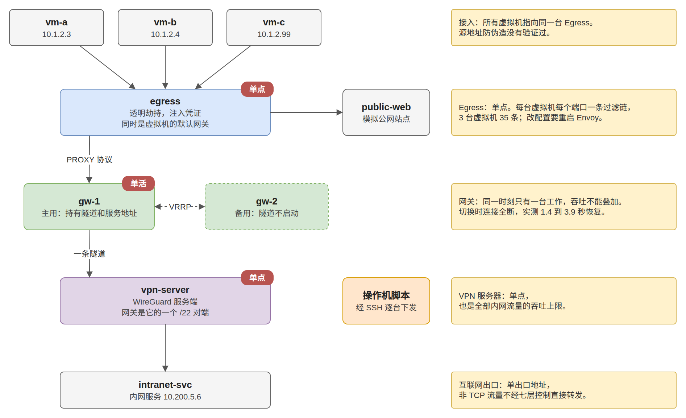

源图：[diagrams/01-current-spof.drawio](diagrams/01-current-spof.drawio)

| 层 | 现状 | 问题 | 性质 |
| --- | --- | --- | --- |
| 虚拟机接入 | 所有虚拟机的默认网关是同一台 Egress | 单点；源地址防伪造没有验证过，而凭证和内网 IP 都按源地址选 | 实验的实现 |
| Egress | 每台虚拟机、每个服务端口一条过滤链；改配置要重启 Envoy | 3 台虚拟机就有 35 条过滤链，规模上不去；每次下发都断连接 | 实验的实现 |
| 网关 | 主备共用一对密钥，同一时刻只有一台工作 | 吞吐不能叠加；切换时连接全断（实测 1.4 到 3.9 秒恢复）；健康检查只看进程在不在，发现不了隧道不通 | 架构加实现 |
| VPN 服务器 | 一台 | 单点；全部内网流量的吞吐上限 | 实验的实现 |
| 互联网出口 | 单出口地址；非 TCP 流量直接转发 | UDP 可以绕过七层控制；对热门目的地的并发连接数受源端口限制 | 实验的实现 |
| 控制面 | 操作机上的脚本经 SSH 逐台下发 | 映射表先清空再逐条添加，中间有空窗；不可达的节点被跳过，没有重试和对账 | 实验的实现 |

这次实际看到的几个数字（2026-11-21，实验重新启动后）：每个节点 1 个 vCPU；两台网关的连接跟踪表上限是 8192；Egress 的配置 44 KB、35 条过滤链；节点上没有压测工具和路由软件。

## 3. 总体架构

目标架构还是基础方案的五层，区别是每一层都有多台，并且明确了每一层靠什么做高可用、靠什么扩展。

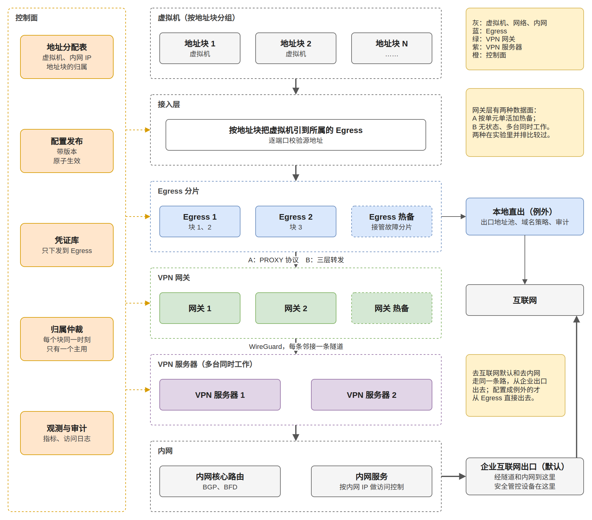

源图：[diagrams/02-target-architecture.drawio](diagrams/02-target-architecture.drawio)

| 层 | 高可用靠什么 | 扩展靠什么 | 有没有连接状态 |
| --- | --- | --- | --- |
| 接入层 | 现有网络的冗余（不在本方案内） | — | 没有 |
| Egress | 按地址块分片，N+1 热备 | 加分片 | 有 |
| VPN 网关，数据面 A | 按单元单活，N+1 热备 | 加单元 | 有 |
| VPN 网关，数据面 B | 多台同时工作 | 加实例 | 没有 |
| VPN 服务器 | 多台同时工作，BGP 加 BFD 选路 | 加实例 | 没有 |
| 控制面 | 数据面不依赖它在线；它自身先单节点，后续三节点 | — | — |

网关层有两种数据面。A 是基础方案已经验证过的做法，B 是把网关改成无状态的做法。两种各有适用条件，第 6 节详细比较。实验里两种都搭出来并排测过，结果见第 6 节和[实验结果](ha-scale-results.md)。

去公网的流量默认也经网关和隧道，从企业的互联网出口出去；配置成例外的才不经过网关和隧道，从 Egress 直接出去。见第 8 节。

## 4. 地址块：调度和故障的最小单位

一个地址块是一段内网地址，加上使用这段地址的虚拟机所在的真实网段，再加上它的归属：由哪台 Egress 处理、（数据面 A 下）由哪个网关单元承载。

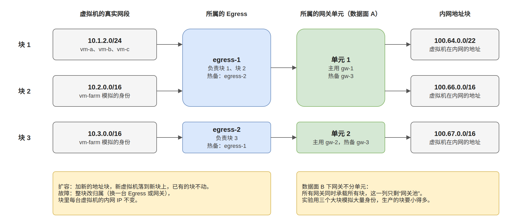

源图：[diagrams/03-block-model.drawio](diagrams/03-block-model.drawio)

控制面维护三张对应关系：

| 对应关系 | 粒度 | 谁使用 |
| --- | --- | --- |
| 虚拟机真实 IP → 内网 IP | 逐台 | 做地址转换的节点（A 是网关，B 是 Egress） |
| 地址块 → 所属的 Egress | 逐块 | 接入层引流；（B）网关的回程路由 |
| 地址块 → 所属的网关单元 | 逐块 | 只有 A 需要：Egress 选上游，VPN 服务器选回程 |

**为什么用块而不是逐台调度。** 引流、选路、来源检查都是按前缀匹配的。按块调度时，这些表的条数是块的数量；逐台调度时是虚拟机的数量，而且每增加一台都要改多个节点的路由。按块之后，新增一台虚拟机只是在已有的块里多一条映射记录。

**对齐的要求。** 新分配的虚拟机，真实网段和内网地址块要成段对应，这样接入层按源地址前缀就能找到它的 Egress。存量虚拟机的内网 IP 已经定了、不能改；如果它们的真实地址和内网地址不是成段对应的，这部分只能逐台处理（每台一条 `/32` 规则）。存量的地址是怎么分布的，需要确认。

**块的大小。** 块越小，一次故障影响的虚拟机越少，调度越灵活，代价是前缀条数多。以 `/22` 为例，一块约一千台，十万台约一百块。一台 Egress 或一个网关单元能带多少块，由实测容量决定，不由地址数决定。

**扩容和故障都以块为单位。**

- 扩容：加新的块，新虚拟机落到新块上，分给新的或负载低的实例。已有的块不动，已有的连接不受影响。
- 故障：整块改归属。块里每台虚拟机的内网 IP 不变，内网侧按 IP 做的访问控制不用改。
- 再平衡：把一个块从一台实例挪到另一台。这个块的已有连接会中断，要放在维护窗口做。

实验里用三个块：

| 块 | 虚拟机真实网段 | 内网地址块 | 所属 Egress | 所属网关单元（A） |
| --- | --- | --- | --- | --- |
| 块 1 | `10.1.2.0/24`（现有的三台虚拟机） | `100.64.0.0/22` | egress-1 | 单元 1 |
| 块 2 | `10.2.0.0/16`（模拟） | `100.66.0.0/16` | egress-1 | 单元 1 |
| 块 3 | `10.3.0.0/16`（模拟） | `100.67.0.0/16` | egress-2 | 单元 2 |

块 2、块 3 各有六万多个地址，是为了用少量的块模拟大量身份。生产里的块要小得多。

**容量怎么估算。** 下面几个量决定每层要多少台。单台容量在实验里测过一轮（见[实验结果](ha-scale-results.md)第 3、6 节），但那是一台实验主机上的数字，只能做相对比较，不能当成生产容量：

- Egress 分片数 ≈ 总请求速率 ÷ 单台 Egress 能处理的请求速率，再加热备。
- 网关上的并发连接数（A）≈ 活跃连接数 + 请求速率 × 上游空闲超时。后一项是 PROXY 协议带来的空闲连接，基础方案里已经实测过。
- 做地址转换的节点上，连接跟踪表的条数 ≈ 它承载的并发连接数，再加上刚关闭、还没过保留时间的连接。实验结果：系统默认的上限是 8192 条，关闭后的记录还要留 120 秒，所以默认值下每秒只能持续新建约 68 条连接，再多表就满了，连管理口都登不上。Egress 和网关都要按容量调这个上限和保留时间。
- Envoy 每个上游集群默认最多 1024 条连接。数据面 A 里网关上的连接数是上面第二条那个数，每秒一百多个请求就会超过，超出的请求返回 503。实验结果：每秒 200 个请求时约四成返回 503。Egress 和网关的配置里都要按容量放宽这个阈值，这是方案配置的一部分，不只是实验的调整。
- 数据面 A 里，一台 Egress 到一个网关单元的所有连接只有源端口不同，本机可用的源端口范围也要放宽。
- 映射表的条数 = 虚拟机数。实验结果：十万条从空表加载 0.4 秒，整表原子替换 0.57 秒，占内核内存约 23 MB，替换期间不影响流量。

## 5. 接入层与 Egress 分片

### 为什么分片，而不是在多台 Egress 之间做等价多路径

Egress 终结虚拟机的 TCP 连接，是有状态的代理。在多台之间按五元组哈希分流（ECMP）对数据面 A 来说其实可行：任何一台 Egress 都能处理任何一台虚拟机。不选它有三个原因：

1. **数据面 B 需要确定的归属。** B 的回程包要回到处理这条连接的那台 Egress，网关只能按内网地址块选路，所以一个块必须固定在一台 Egress 上。按块分片让 A 和 B 用同一套接入设计。
2. **成员变化时不打扰无关的连接。** 普通的哈希在增减成员时会把一部分已有连接重新分到别的实例上，这些连接本来不用断。按块分片时，加一台实例只影响分给它的新块。
3. **故障范围可预期。** 一台 Egress 故障，受影响的就是它负责的那几个块。

### 引流

每个块有一个接入地址，由当前负责这个块的 Egress 持有。接入路由器按源地址所在的块做策略路由，下一跳是这个块的接入地址。

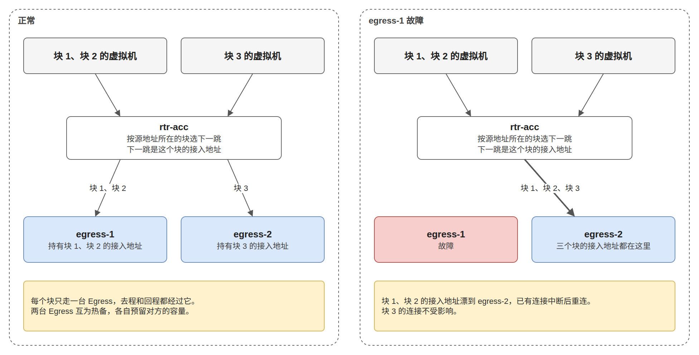

源图：[diagrams/04-access-failover.drawio](diagrams/04-access-failover.drawio)

实验里接入路由器 `rtr-acc` 上的规则（示意）：

```bash
# 目的地址在虚拟机一侧的走主表，优先级要比下面按块的规则高
ip rule add to 10.1.2.0/24 lookup main priority 900
ip rule add to 10.2.0.0/16 lookup main priority 900
ip rule add to 10.3.0.0/16 lookup main priority 900
# 按源地址所在的块选路由表
ip rule add from 10.1.2.0/24 lookup 101 priority 1000
ip rule add from 10.2.0.0/16 lookup 101 priority 1000
ip rule add from 10.3.0.0/16 lookup 102 priority 1000
# 每张表的默认路由指向这个块的接入地址
ip route add default via 10.1.254.101 table 101   # 块 1、块 2
ip route add default via 10.1.254.102 table 102   # 块 3
```

开头“走主表”的几条是实验里补上的。接入路由器在虚拟机一侧的网卡上开着反向路径检查（见下面的“源地址校验”），没有这一条时，发给路由器自己的包反查路由会命中块的规则，出口成了 Egress 那一侧，被当成伪造的丢掉，虚拟机连默认网关都到不了。实验里用的完整规则在 [`lab/eve-ng/files/rtr-acc-boot.sh`](../lab/eve-ng/files/rtr-acc-boot.sh)。

回程不需要特别处理：Egress 终结了虚拟机的连接，回包由它自己发出，经接入路由器回到虚拟机。

生产环境里“接入路由器”对应什么，取决于虚拟化平台：可能是每个子网的路由表（下一跳指向 Egress 实例），也可能是宿主机虚拟交换机上的转发规则。这一点要向平台的维护方确认。

已确认虚拟机在云平台上，流量现在是靠宿主机上的转发规则引到 Egress 的（2026-11-21）。所以“接入路由器”在生产里对应的就是宿主机上的这套规则：按块引流要求它能按虚拟机所在的子网指向不同的 Egress，接管要求它的指向能被快速改掉，或者指向一个能漂移的地址。这两点要向维护这套规则的团队确认。源地址校验也适合放在宿主机这一层做。

云平台还带来一个要先查清的问题：不少云平台的网络不支持 VRRP 这种靠通告抢地址的漂移。如果是这样，接入地址和网关服务地址的接管要换成平台自己的机制，比如通过接口修改子网路由表的下一跳，或者平台提供的高可用虚拟地址。实验里用 keepalived 验证的是接管的逻辑和时间的量级，不能代表平台上的实现。

### 故障接管

实验里用 keepalived 让接入地址在 Egress 之间漂移，每个块组一个 VRRP 实例。两台 Egress 互为热备：egress-1 是块 1、块 2 的主用和块 3 的备用，egress-2 反过来。

接管时发生的事：

1. 备用的 Egress 在连续几个通告周期收不到主用的通告后，把接入地址配到自己的网卡上。
2. 接入路由器的下一跳地址没变，但它现在指向备用的那台。
3. 故障 Egress 上的连接全部中断。虚拟机重连时，连接落到备用的那台上。
4. （数据面 B）回程也要一起切到备用的 Egress，做法见第 6 节“回程怎么回到处理这条连接的 Egress”。

两个前提：

- **备用的 Egress 要预先有它可能接管的块的全部数据**：凭证、策略、（B）地址映射。不能等接管时再去拉。
- **容量要预留。** 两台互为热备时，每台平时只能用到一半；N 台加一台专用热备时，预留的是一台的容量。实验里只有两台 Egress，所以是互为热备；生产里建议专用热备。

**实验结果。** 一台 Egress 断电：它负责的块，新连接约 4.0 秒后恢复（VRRP 通告间隔 1 秒），已有的长连接全部中断；另一台负责的块新连接 0 失败、长连接 0 中断。两种数据面下都是这样（数据面 B 是 4.1 和 4.4 秒）。接管后访问内网的来源不变；访问公网的来源变成接管那台的出口地址。

**恢复之后归属怎么回去。** 实验里 Egress 的接入地址配成了抢占：原来的那台恢复后自己把块拿回去。拿回去的那一下新连接几乎不受影响（每秒 300 条里失败 0 到 1 个），但这组块上已有的连接会再断一次。后一点是按机制推出来的，没有专门测。生产里要不要抢占、放在什么时候切回，要单独定；网关单元配的是不抢占，恢复的那台回来是备用。

### 源地址校验

凭证和内网 IP 都按源地址选。一台虚拟机冒用另一台的源地址，就同时拿到对方的两个身份。所以源地址必须在虚拟机接入网络的那个端口上校验，过了这一点就没法区分了。

- 生产：宿主机虚拟交换机的端口安全（端口和 IP、MAC 绑定）。
- 实验：模拟大量虚拟机的节点里，用网络命名空间加网桥，在网桥上按端口过滤源地址，可以真实地测“同网段冒用”。接入路由器上再开反向路径检查，拦跨网段的冒用。

这一项在基础方案里一直列为未验证。**实验结果：只补上了跨网段的一半。** 模拟虚拟机的节点冒用块 1 里一台虚拟机的地址发包，接入路由器开着反向路径检查时到达 Egress 的包是 0 个，关掉检查后能到达（对照成立）。同网段内冒用别人的地址（用网络命名空间加网桥按端口过滤来测）没有做，仍然是未验证。

## 6. 网关层的两种数据面

### 数据面 A：PROXY 协议加四层网关

这是基础方案的做法。单个单元的主备在基础方案里验证过；两个单元加共享热备这次也在实验里验证了，用的是下面的“过渡做法”。

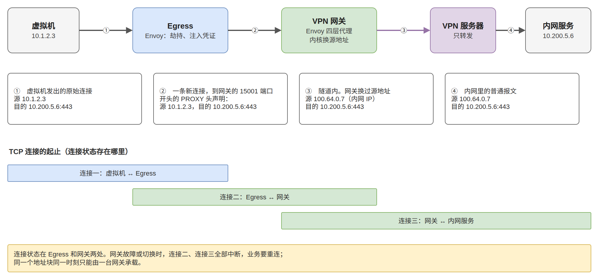

源图：[diagrams/05-dataplane-a.drawio](diagrams/05-dataplane-a.drawio)

一条访问内网的请求经过三条 TCP 连接。Egress 和网关各自终结一次，所以连接状态在两处。

**水平扩展靠加单元。** 一个单元是一组地址块、一个服务地址和一台主用网关。Egress 上每个单元配一个上游集群，按来源前缀选单元。集群的条数随单元数增长，不随虚拟机数增长。

**热备是共享的。** 每台网关都带全量的映射表和所有单元的配置，都能承载任何单元，区别只是优先级：

| 单元 | 第一顺位 | 第二顺位 | 第三顺位 |
| --- | --- | --- | --- |
| 单元 1 | gw-1 | gw-3 | gw-2 |
| 单元 2 | gw-2 | gw-3 | gw-1 |

一台故障时由 gw-3 接管；两台故障时剩下的一台承载两个单元，前提是容量够。

**实验结果。** 承载块 3 的 `gw-2` 断电：`gw-3` 接管了单元 2，块 3 的新连接 3.8 秒后恢复，已有的长连接全部中断；单元 1 的块新连接 0 失败、长连接 0 中断。VPN 服务器的配置没有改，它自动学到了新的对端地址。3.8 秒里大部分是检测时间（VRRP 通告间隔 1 秒）；把通告间隔改成 0.2 秒是 1.9 秒，剩下的是隧道握手和 Egress 上连接重建的时间。`gw-2` 恢复后是备用，不抢回；用“让出”开关正常切回时中断 1.5 到 1.8 秒。一台网关同时承载两个单元也实际出现过，两个块的身份都正确，做法是每个单元一张路由表、按连接的源地址选表，配置在 [`config/vpn-gateway/multi-unit/`](../config/vpn-gateway/multi-unit/)。

**接管的过程：**

1. 热备在几个通告周期收不到主用的 VRRP 通告，把这个单元的服务地址配到自己的网卡上。
2. 热备开始承载这个单元的隧道流量。这一步有两种做法，见下面“密钥和接管方式”。
3. Egress 的新连接到达热备。原来的连接（连接二、连接三）全部要重建。

**密钥和接管方式。**

| | 过渡做法（第 1 期） | 目标做法（第 2 期起） |
| --- | --- | --- |
| 密钥 | 每个单元一对，能承载这个单元的网关都持有 | 每台网关自己一对 |
| 隧道 | 只有主用启动这个单元的隧道 | 每台网关到每台服务器的隧道一直建着 |
| 接管时 | 热备用单元的密钥启动隧道，VPN 服务器自动学到新的对端地址 | 热备开始通告这个单元的地址块，VPN 服务器按路由把回程交给它 |
| VPN 服务器要不要改配置 | 不用 | 不用 |
| 状态 | 单个单元的主备、两个单元加共享热备都已验证 | A 上没有验证；它依赖的“每台网关一个隧道接口加多条等价路由”在数据面 B 上跑通了（只有一台服务器，没有用 BGP） |

过渡做法沿用已经验证过的机制，可以先把多单元跑起来。目标做法依赖第 7 节的“每条邻接一个隧道接口”，好处是密钥不共用（可以单独吊销一台网关）、接管不用等握手。

**谁是主用，以及两台都以为自己是主用时会怎样。** 实验用 VRRP 决定主用。VRRP 在两台之间的网络断开时，可能两台都认为自己是主用。后果按做法不同：

- 过渡做法：两台用同一对密钥抢 VPN 服务器上的对端地址。实验里遇到过一次，中断约 20 秒。
- 目标做法：两台都通告同一个块，回程在两台之间分摊。落到“没有这条连接”的那台上的包被拒绝，表现为这个单元的连接大面积失败。不会出现身份错乱，因为 VPN 服务器的来源检查和网关的映射表都还在。

要彻底防住，需要外部的归属仲裁（租约）加上把旧主隔离开，VRRP 和 BGP 自己都做不到。实验先把“网络分区”作为一项故障注入，测出实际后果，再决定仲裁放在哪一期做。这项故障注入还没有做。

**健康检查要看隧道通不通。** 现在 keepalived 只检查 Envoy 进程在不在。主用的隧道不通而进程还在时，不会切换。要加上：最近一次握手的时间、（目标做法）BGP 会话的状态、对 VPN 服务器隧道内地址的探测。这一条在数据面 A 上还没有做；数据面 B 的“就绪地址”做的就是这件事，见下文。

**A 的固有代价：**

- 每条内网连接要经过两次用户态转发。
- 每条虚拟机的连接在 Egress 和网关之间对应一条独立的连接，不同虚拟机之间不能复用。网关上常驻的空闲连接数是“请求速率 × 空闲超时”。
- 网关故障或切换，这个单元的连接全断。
- 同一个地址块同一时刻只能由一台网关承载，单个单元的吞吐上限是一台网关。

### 数据面 B：地址转换搬到 Egress，网关只转发

思路是把现在网关上的内核逻辑（映射表、标记、策略路由）搬到 Egress 节点上。Envoy 仍然以虚拟机的真实 IP 为源发起上游连接，Egress 的内核在出接口上把源地址换成内网 IP。网关上不再运行 Envoy，不做地址转换，不跟踪连接，只做路由和隧道。

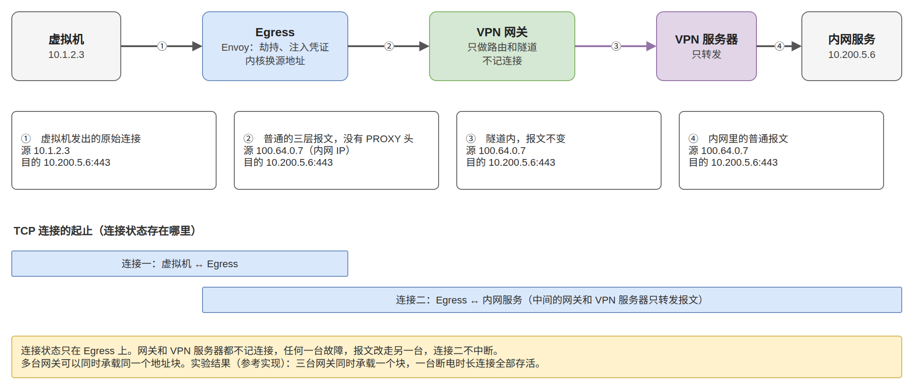

源图：[diagrams/06-dataplane-b.drawio](diagrams/06-dataplane-b.drawio)

访问内网的请求只经过两条 TCP 连接，第二条的两端是 Egress 和内网服务。中间的网关和 VPN 服务器都只转发报文。

**这样做得到三样东西：**

1. 网关故障不断连接。连接的状态不在网关上，报文改走另一台网关，连接照常。
2. 同一个地址块可以由多台网关同时承载。网关不分单元、没有主备，设计上吞吐随台数叠加。实验里只看到“从一台到三台有增加”，叠加到什么程度没有测出来，见下面的实验结果。
3. 少一次用户态转发，也没有 Egress 到网关的那一层连接。

**Egress 节点上要加的内核规则（示意；实验里调通的完整规则在 [`config/dataplane-b/egress-b.nft`](../config/dataplane-b/egress-b.nft)）：**

```
table ip egress_b {
	# 虚拟机真实 IP : 内网 IP，由控制面维护
	map vm2intra { type ipv4_addr : ipv4_addr; }
	# 走数据面 B 的内网地址块
	set b_intra { type ipv4_addr; flags interval; }

	# 上游一侧的连接放进单独的连接跟踪分区，虚拟机一侧留在默认分区，原因见下文
	chain zone_out { type filter hook output priority raw; meta mark 123 ct zone set 1 }
	chain zone_in  { type filter hook prerouting priority raw; iifname "网关侧网卡" ip daddr @b_intra ct zone set 1 }

	# Envoy 以虚拟机地址发起的上游连接带标记 123，记到连接上；回程包再把标记打回去
	chain out_mark { type filter hook output priority mangle; meta mark 123 ct mark set 123 }
	chain in_mark  { type filter hook prerouting priority mangle; iifname "网关侧网卡" ct mark 123 meta mark set 123 }

	# 出网关侧网卡之前，把源地址从虚拟机真实 IP 换成内网 IP
	chain snat_out { type nat hook postrouting priority srcnat; oifname "网关侧网卡" meta mark 123 snat to ip saddr map @vm2intra }
}
```

另外要有和现在网关上一样的策略路由：带标记 123 的回程包交给本机，而不是转发走。

**回程怎么回到处理这条连接的 Egress。** 回程包的目的地址是虚拟机的内网 IP。网关按内网地址块选路，下一跳是这个块所属的 Egress。

这带来一个约束：一个块“归哪台 Egress”，在接入侧（谁持有接入地址）和网关侧（回程交给谁）必须一致，并且要一起切换。实验里没有用路由协议：每组块在 Egress 和网关之间的网段上再放一个“回程地址”，和接入地址放在同一个 VRRP 实例里一起漂移，网关上这组块的路由指向这个回程地址。Egress 断电的测试里两个地址确实一起切到了另一台。用路由协议由 Egress 通告它负责的块是另一种做法，没有验证。

**网关上要做的事：**

- 不跟踪转发的连接（`notrack`）。跟踪了的话，去程和回程走不同网关时会被当成无效包丢掉。
- 按来源限制源地址：从某台 Egress 来的包，源地址只能在它负责的块里。这是 A 里“15001 端口只接受 Egress 的地址”的对应物。
- 调整 TCP 的最大报文段长度。连接的两端现在是 Egress 和内网服务，中间要过隧道，隧道的 MTU 比普通链路小。
- 自己判断是否就绪。转发已经打开、并且经自己的隧道能通到 VPN 服务器时，才在面向 Egress 的网卡上配一个“就绪地址”，Egress 只探测这个地址。这一条是实验里补上的：只探测网卡地址时，网关重新开机后网卡一通就被放回去，那时隧道还没握手，约 1 秒内分给它的新连接都失败了。

**B 要成立，另外还要三样东西（实验里补上的）：**

- **每台网关一条自己的隧道。** 同一个块要由多台网关同时承载，而 WireGuard 的一个接口上同一段地址只能属于一个对端。所以 VPN 服务器上给每台网关建一个接口，网关用自己的密钥，隧道一直建着。这就是第 7 节“每条邻接一个隧道接口”的做法。原来的接口不动，可以并存。
- **多条等价路由。** VPN 服务器上这个块的回程路由、Egress 上去内网的路由，都有多个下一跳，按五元组分流。同一条连接的去程和回程可能经过不同的网关。
- **探测并摘除不通的下一跳。** 完整的做法是隧道里跑 BGP 加 BFD（第 7 节）。实验里用一个探测脚本代替：每 0.2 秒探测一次每个下一跳，连续 3 次没有应答就把它从路由里摘掉，恢复后放回。这是让 B 在实验里成立的最小实现，不是生产方案。

**五个要先验证的点，任何一个不成立 B 都不能用。** 实验结果是四个成立，第五个部分成立，逐条写在每一点后面；数字和测法见[实验结果](ha-scale-results.md)第 5、6 节。

1. **连接池的隔离。** A 里是 PROXY 头让 Envoy 给每条下游连接单独建上游连接。去掉 PROXY 头之后，要确认 Envoy 的上游连接池仍然按源地址分开，不会把一台虚拟机的请求放到以另一台虚拟机的地址建立的连接上。如果成立，同一台虚拟机的多个请求还能复用连接，空闲连接比 A 少。**实验结果：成立。** 三种压法共 51 万个七层请求，内网服务看到的来源错的是 0 个；同一个身份的 40 个请求只用了 2 条上游连接，A 是 40 条。
2. **连接跟踪的冲突。** Envoy 上游连接的源地址是虚拟机的 IP，源端口由 Egress 的内核选。这个端口可能和虚拟机自己那条连接的源端口相同，两条连接在连接跟踪里是同一个五元组，后建的那条会被丢弃。把虚拟机一侧和上游一侧放进不同的连接跟踪分区可以避开。**实验结果：冲突确实出现，分区能避开，但放进单独分区的必须是上游一侧。** 不分区时，构造出来的压法下有 3924 到 5702 个请求失败，分区后是 0 个；两种情况下身份不符都是 0，冲突的后果是连不通，不是串到别人身上。这份文档原先写的是把虚拟机一侧放进单独的分区，照那样做 Egress 上所有连接都不通：透明劫持靠 `SO_ORIGINAL_DST` 取回虚拟机原本要访问的地址，内核只在默认分区里找这条记录。上面的示意规则已经按实验改过来了。
3. **回程能交回本机的 Envoy。** 包括反向路径检查的设置、策略路由的优先级、和透明劫持的重定向规则是否互相干扰。**实验结果：成立。** 靠的是一条策略路由，去掉它就不通，放回去恢复；和透明劫持的规则互不干扰。Egress 上的反向路径检查是关着的（系统默认），开着会不会拦回程包没有测。
4. **网关断电时连接确实不断。** 要用一条持续传输的长连接来测，而不是每次新建连接。**实验结果：成立。** 三次断电，60 条持续传输的长连接每次都全部存活、没有丢数据，最长卡了 1.5 秒；新连接 0.9 到 1.0 秒后恢复。同一台网关上走 A 的 60 条每次全断。这个结论只到网关这一层：实验里只有一台 VPN 服务器，网关到内网服务之间没有按连接状态过滤的设备，见第 7 节关于防火墙的说明。
5. **性能确实更好。** 和 A 在同样的节点规格下比吞吐、建连速率、延迟和 CPU。**实验结果：部分成立。** 请求多、连接短的负载 B 明显好：新建连接速率高 60% 到 100%，长连接的请求速率高 15% 到 60%，延迟略低。大流量的 TCP 吞吐 B 没有更好：B 用三台网关和 A 用一台差不多，都在 2.3 到 2.6 Gbit/s 附近；只留一台网关时，B 的一台能转发的下行流量约是 A 的一台的七成（这一项只有一到两遍的数字）。B 从一台加到三台，吞吐只多了三到五成，卡住的不是网关，判断是实验平台的虚拟网卡，所以“随台数叠加”到什么程度在这个实验里测不出来。

**Egress 到网关这一跳怎么保护。** 同一个机房、专用网段的情况下，网关上按来源过滤就够了。要跨不可信的网络时，这一跳可以用 WireGuard：每台 Egress 一个对端，`AllowedIPs` 写它负责的块，正好就是“按来源限制源地址”，代价是多一次加解密。

**B 的代价是对真实 Egress 的改动大。** A 只要求 Egress 加一个带 PROXY 协议的上游。B 要求在 Egress 节点上加内核的地址转换、连接跟踪分区和策略路由，Envoy 进程要有网络管理权限、多两个监听器，节点上要带全量的映射表，去内网的路由要有多个下一跳并且有东西负责探测和摘除（实验里是探测脚本，生产里是路由软件或者等价的机制）。真实的 Egress 由别的团队维护，连是不是 Envoy、是不是透明劫持都还没确认。所以 B 能不能用，首先取决于 Egress 的维护方接不接受这些改动。

### 一台网关故障时的差别

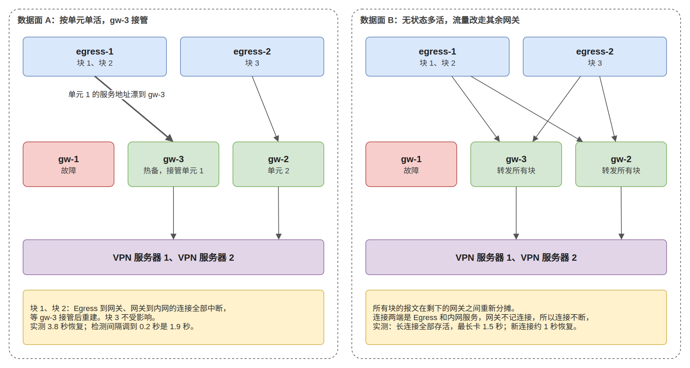

源图：[diagrams/07-gateway-failure.drawio](diagrams/07-gateway-failure.drawio)

### A 和 B 的比较

| | 数据面 A | 数据面 B |
| --- | --- | --- |
| 网关上的状态 | Envoy 的连接、连接跟踪、映射表 | 没有连接状态 |
| 同一个块能由几台网关承载 | 一台 | 多台 |
| 一台网关故障 | 这个单元的连接全断，等热备接管。实验结果：新连接 3.8 秒恢复，检测间隔 0.2 秒时 1.9 秒 | 连接不断，短暂丢包。实验结果：长连接全部存活，最长卡 1.5 秒；新连接 0.9 到 1.0 秒恢复 |
| 一次请求经过几次用户态转发 | 两次 | 一次 |
| 虚拟机的身份怎么传给下一跳 | PROXY 头 | 报文的源地址本身 |
| 地址转换在哪里做 | 网关 | Egress |
| 对真实 Egress 的要求 | 加一个带 PROXY 协议的上游，放宽熔断阈值 | 内核地址转换、连接跟踪分区、策略路由、全量映射表、多条等价路由加探测、进程权限 |
| 归属仲裁 | 需要（每个单元谁是主用） | 网关不需要；Egress 仍然需要 |
| 请求类负载（实验结果） | 基准 | 新建连接速率高 60% 到 100%，长连接的请求速率高 15% 到 60% |
| 大流量吞吐（实验结果） | 一台网关下行约 2.3 到 2.5 Gbit/s | 三台网关合起来和 A 的一台差不多；一台约是 A 的一台的七成 |
| 验证状态 | 单个单元的主备、两个单元加共享热备都已验证 | 在参考实现上已验证：五个验证点四个成立、一个部分成立。真实的 Egress 没有验证 |

两种都在实验里搭出来，用同一套故障注入和压测各跑了一遍（2026-11-21）。A 可以作为长期保底：它的代价是性能和切换时断连接，不是架构不成立。

**怎么看这次的对比。** 业务能接受断开后重连，所以 B“网关故障连接不断”是加分项；B 的价值主要看容量。这次的数据对 B 并不一边倒：请求多、连接短的负载 B 明显好；大流量吞吐 B 没有优势，而且两种数据面的总吞吐都被实验平台挡在 2.3 到 2.6 Gbit/s 附近。互联网流量默认也走隧道之后，大流量吞吐最要紧，而这一点正好是这个实验下不了结论的：要有多台物理机，或者至少网卡有多队列和内核加速的环境，才能看出 B 加网关能叠加多少。在那之前，不能把“B 的吞吐随台数叠加”当成已经证实的结论来做容量规划。

实验里可以按地址块选数据面：块 1、块 2 走 A，块 3 走 B，两种同时在跑。

### 没有采用的做法

**让 Egress 自己直接和 VPN 服务器建隧道，取消网关这一层。** 技术上更简单，少一跳。没有采用是因为：隧道密钥会落到 Egress 上，而 Egress 是处理虚拟机流量、暴露面最大的一层；VPN 服务器上的对端数随 Egress 实例数增长，Egress 扩缩容都要动 VPN 服务器；Egress 的维护方要一起管 VPN。保留网关这一层，可以让 Egress 的扩容和 VPN 的运维互不牵扯。

**Egress 到网关改用 mTLS 上的 HTTP/2 CONNECT。** 它能认证 Egress 实例、复用连接，但网关上的代理状态还在，切换照样断连接，还多了多条连接共用一条 TCP 时的队头阻塞。它解决的问题 B 都解决了，而且 B 解决得更彻底。

**每台虚拟机一条隧道。** 它能让 VPN 管理控制台逐台断开虚拟机，但隧道、密钥和接口的数量都随虚拟机增长。同样的断开效果可以用别的办法得到，见第 9 节的[逐台阻断](#逐台阻断不靠逐台隧道)。

## 7. VPN 服务器多台同时工作

### 每条邻接一个隧道接口

WireGuard 在一个接口上，同一段地址只能属于一个对端。基础方案里一台服务器一个接口、网关是其中一个对端，所以地址块只能写给一个网关，也只能连一台服务器。

要让多台网关和多台服务器两两相连，做法是每条“网关到服务器”的邻接用一个独立的隧道接口。不同接口的 `AllowedIPs` 互不影响，同一个地址块可以写进多个接口。实际走哪个接口，由路由表决定。

**实验结果：这一节只有一部分跑过。** 数据面 B 已经用了“每台网关一个隧道接口，加多条等价路由”：一台 VPN 服务器上三个接口，各对一台网关，和原来的接口并存；一台网关断电后回程改走另外两台，已有连接不断。没有跑过的是：第二台 VPN 服务器、内网核心路由器、隧道里的 BGP 和 BFD（实验里用探测脚本代替）、服务器断电。另外观察到一个现象：服务器上的隧道接口重建之后，要等网关那一头下一次发包才会重新握手，网关配的保活间隔是 25 秒，所以最长要等这么久。

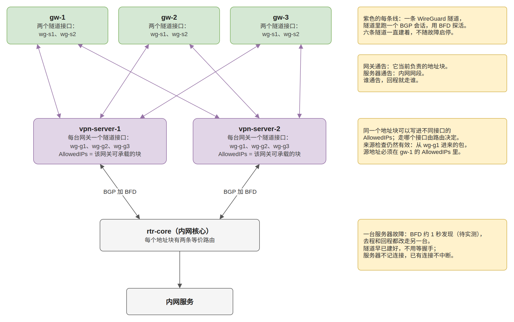

源图：[diagrams/08-vpn-server-ha.drawio](diagrams/08-vpn-server-ha.drawio)

`vpn-server-1` 上对 `gw-1` 的接口（示意）：

```ini
# /etc/wireguard/wg-g1.conf
[Interface]
PrivateKey = <vpn-server-1 的私钥>
ListenPort = 51821            # 每个接口一个端口
Address = 169.254.1.0/31      # 隧道内的互联地址，给 BGP 用
Table = off                   # 不按 AllowedIPs 自动加路由，路由交给 BGP

[Peer]
PublicKey = <gw-1 的公钥>
# gw-1 可能承载的全部地址块，加上隧道内对端的互联地址
AllowedIPs = 169.254.1.1/32, 100.64.0.0/22, 100.66.0.0/16, 100.67.0.0/16
```

`gw-1` 上对 `vpn-server-1` 的接口（示意）：

```ini
# /etc/wireguard/wg-s1.conf
[Interface]
PrivateKey = <gw-1 的私钥>
Address = 169.254.1.1/31
Table = off

[Peer]
PublicKey = <vpn-server-1 的公钥>
Endpoint = <vpn-server-1 的地址>:51821
AllowedIPs = 169.254.1.0/32, 10.200.0.0/16
PersistentKeepalive = 25
```

每台节点一对密钥，用在它所有的接口上。三台网关、两台服务器一共六条隧道，一直建着，不随故障启停。

### 用路由决定走哪条

每条隧道里跑一个 BGP 会话，用 BFD 探测对端是否还活着：

- **网关通告它当前负责的地址块。** A 下是它作为主用的那些单元的块；B 下是全部的块。
- **服务器通告内网网段。**
- **服务器再把学到的地址块通告给内网核心。** 内网核心对每个块有多条等价路由。

谁通告，流量就走谁。A 下热备接管一个单元，就是它开始通告这个单元的块；B 下每台网关都通告所有的块，回程在它们之间分摊。

`AllowedIPs` 在这里只起“上限”的作用：它规定这条隧道最多允许哪些地址，实际用不用由路由决定。来源检查仍然有效：从 `wg-g1` 进来的包，源地址必须在 `gw-1` 的 `AllowedIPs` 里，否则 WireGuard 直接丢弃。

这和基础方案文档里“不使用 BGP 通告”的说法不矛盾，但要修订那句话。那句话的前提是一个接口上有多个对端：这时 `AllowedIPs` 决定包发给哪个对端，路由协议改变不了。每条邻接一个接口之后，接口之间的选择就是普通的路由问题了。

### 故障时的行为

| 故障 | 怎么发现 | 之后 |
| --- | --- | --- |
| 一台服务器断电 | 各网关和内网核心上的 BFD 超时 | 去程和回程都改走另一台服务器 |
| 一台网关到一台服务器之间的路径不通，两端都还活着 | 这条隧道里的 BFD 超时 | 只撤掉这一条邻接的路由，其余五条不受影响 |
| 服务器重启后回来 | BGP 会话重新建立 | 会话建立、路由学到之后才开始引流 |

两点值得注意：

- **不用等握手。** 另一台服务器的隧道早就建好了，切换只是换一条路由。现在的做法里，切换要等新的握手完成。
- **已有连接不断。** 服务器只转发报文，不做地址转换，不跟踪连接。去程和回程走不同的服务器也没有问题。这以真实的 VPN 服务器同样不做地址转换、中间没有按连接状态过滤的设备为前提，需要确认。

**VPN 服务器和内网之间有一层按连接状态过滤的防火墙（2026-11-21 确认）。** 它决定“已有连接不断”能不能成立：

- 如果所有 VPN 服务器的流量经过的是同一套防火墙（同一台，或者同步连接状态的一组），去程和回程走不同的服务器、一台服务器坏了换另一台，防火墙都认得这条连接，上面的结论成立。
- 如果每台 VPN 服务器后面是各自独立的防火墙，回程从另一台回来会被当成无效包丢掉。这时要改成按块指定主用的服务器，让同一个块的去程和回程走同一台，另一台只做备用。两台服务器仍然同时在干活（各管各的块），但一台坏了的时候，它那些块的连接会断，重连后恢复。业务能接受重连，所以这个退路是可行的。

是哪一种还要确认。

BFD 的检测时间计划设成 1 秒左右（300 毫秒一次，连续 3 次失败）。BFD 跑在 WireGuard 接口上能不能稳定工作、实际多久恢复，都要实测。

### 和迁移并存的关系

基础方案的迁移靠的是：VPN 服务器的同一个接口上，每台虚拟机的 `/32` 对端和网关的地址块并存，`/32` 优先。

改成每条邻接一个接口之后，旧的那个接口（带着每台虚拟机的 `/32` 对端）继续保留。并存的依据从“同一个接口里最长前缀优先”变成“路由表里最长前缀优先”：`/32` 的路由指向旧接口，地址块的路由指向网关的接口。原理一样，但换了一层来实现，迁移和回退要重新验证一遍。

### 服务器的扩展

每台服务器承担全部内网流量的一份。加一台服务器，每台网关多一条邻接，内网核心多一条等价路由。服务器上的接口数等于网关的台数，不随虚拟机数增长。

## 8. 互联网出口

去公网的流量有两种出法：经企业的互联网出口，或者从 Egress 直接出去，见下面的“出口模式”。规划是所有虚拟机默认经企业出口，保留一部分本地直出（2026-11-21 确认）。本地直出这条路要做四件事：分类、策略、换出口地址、审计。

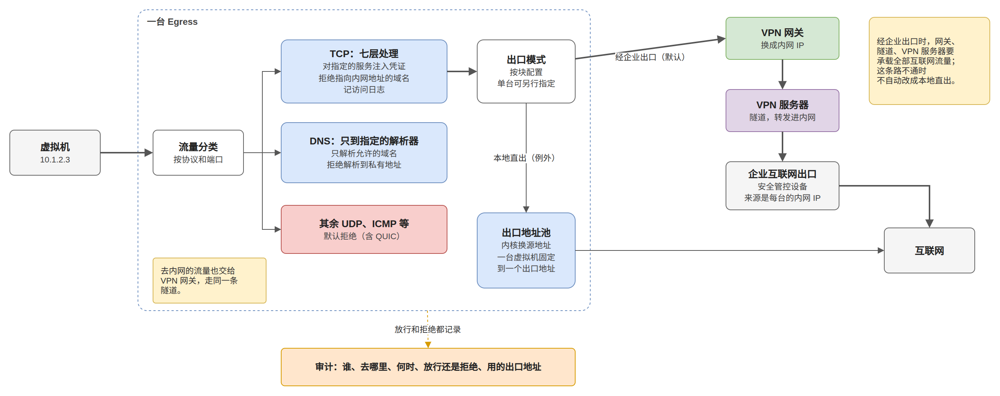

源图：[diagrams/09-internet-egress.drawio](diagrams/09-internet-egress.drawio)

### 出口模式：本地直出，或者经企业的互联网出口

每个地址块可以配置互联网流量从哪里出去，单台虚拟机可以另行指定。这是 2026-11-21 加进来的要求：让虚拟机的互联网访问经过企业已有的互联网安全管控设备。

| 模式 | 路径 | 谁来管控 |
| --- | --- | --- |
| 本地直出 | Egress 的出口网卡直接到公网 | Egress 上的策略，见后面几小节 |
| 经企业出口 | Egress、网关、隧道、VPN 服务器、内网、企业的互联网出口，再到公网 | 企业已有的互联网安全管控设备，加上 Egress 上的基本检查 |

经企业出口时，去公网的连接和去内网的连接走同一条路，区别只是目的地址不在内网：

- 数据面 A：Egress 把去公网的连接也交给网关，PROXY 头里写着虚拟机的地址和公网的目的地址。网关照常换成内网 IP，从隧道发出去。
- 数据面 B：Egress 换成内网 IP 之后按路由交给网关。
- 网关上，带标记的流量的默认路由指向隧道；网关一侧隧道接口的 `AllowedIPs` 从内网网段放宽到全部地址。隧道自身的外层报文不带标记，仍然走承载网，不会绕进隧道。
- VPN 服务器和内网把这些包按普通路由送到企业的互联网出口，由它做地址转换后发往公网。回程按内网 IP 的路由回到 VPN 服务器。

这样做得到三样东西：

- 企业的管控设备看到的来源是每台虚拟机自己的内网 IP，可以按虚拟机做策略和审计。
- 第 9 节的逐台阻断同时切断这台虚拟机的互联网访问。
- 这个模式下不需要 Egress 上的出口地址池，对外的地址由企业出口决定。

代价：

- 网关、隧道、VPN 服务器要承载全部互联网流量，通常比内网流量大得多。这三层的容量要按互联网流量来算，数据面 B 和多台服务器同时工作的价值更大。
- 网关或 VPN 这一层出故障时，互联网访问跟着受影响。本地直出时两者互不影响。
- 多绕一段路，延迟增加；报文多一层隧道封装。

三条规则：

- **企业出口这条路不通时，默认不放行。** 不自动改成本地直出，否则让链路断一下就能绕开管控。是否允许降级做成配置项，默认不允许。
- **可以配置例外。** 指定的目的地（例如软件源、云平台的接口）仍然本地直出。例外名单按目的写，不按虚拟机写。
- **Egress 上的三项检查在两种模式下都保留：** 非 TCP 默认拒绝、查出来是内网或基础设施地址的一律拒绝、审计。按域名的策略在这个模式下可以交给企业的设备。

2026-11-21 确认的情况：

- 企业的管控设备是串在路上透明处理的，不要求显式指定代理，所以上面的做法适用。
- 它不做 TLS 解密。虚拟机和 Egress 不需要信任额外的根证书，Egress 代为注入的凭证不会被它看到；它能管控的是地址、端口、握手里的域名和流量特征。
- 企业出口的容量会扩容。
- 默认所有虚拟机都经企业出口，保留一部分本地直出。上面三条规则（不通时不放行、可以配置例外、Egress 上的基本检查保留）确认采用。

这一小节的机制全部没有在实验里验证过。因为它成了默认的出口，网关、隧道、VPN 服务器的容量要按“内网流量加全部互联网流量”来规划。

### 分类：非 TCP 默认拒绝

现在实验里 Egress 把虚拟机发来的非 TCP 流量直接转发出去。这是为了让“现状”阶段虚拟机自带的隧道（UDP）能通，但它同时让任何 UDP 流量都绕过了七层控制。

目标是默认拒绝，按需放行：

| 流量 | 处理 |
| --- | --- |
| TCP | 全部进七层处理 |
| DNS | 只允许发到指定的解析器（可以就在 Egress 上） |
| 其余 UDP，包括 QUIC | 拒绝。浏览器和客户端库在 QUIC 不通时会退回到 TCP 上的 TLS |
| ICMP 等 | 拒绝，或只放行排障需要的几种 |
| 迁移期间旧隧道的 UDP | 只对还没迁移的虚拟机、只到 VPN 服务器的地址和端口放行，迁移完一台关一台 |

### 策略：按域名，并且不相信虚拟机给的目的地址

- 明文 HTTP 看 Host，TLS 看握手里的服务器名称（SNI）。
- **只看这两个不够。** 虚拟机可以在 SNI 里写一个允许的域名，却把连接发往自己控制的地址。对 TLS 透传的流量，应当由 Egress 自己解析这个域名，连到解析结果上，不采用虚拟机给的目的地址。Envoy 有按 SNI 动态转发的过滤器，能不能满足这里的要求要在实验里验证。
- 解析结果是私有地址、内网网段或者基础设施网段的，一律拒绝。否则虚拟机可以借一个指向内网地址的公网域名，从互联网这条路绕进内网。
- 凭证注入的做法不变：只对指定的服务注入，目的地址、端口、Host 都要匹配，由 Egress 向服务发起 TLS。这部分已在实验里验证过，见[基础方案的“凭证不落到虚拟机”](design.md#凭证不落到虚拟机)。

### 出口地址池

一个出口地址，对同一个目的地址和端口，并发连接数受源端口数量限制，上限在几万条的量级。对不同的目的地互不影响，所以瓶颈出现在热门的目的地上：大量虚拟机同时访问同一个站点时。

给每台 Egress 配一段出口地址，上限就乘以地址的个数。做法和数据面 B 是同一个机制：Envoy 以虚拟机的地址为源发起连接，内核在出接口上把源地址换成地址池里的一个。让同一台虚拟机固定换成同一个出口地址，这样对端看到的来源稳定，审计时也容易对应。

如果真实的 Egress 不能改成“以虚拟机地址为源”，就要用别的办法给它多个出口地址，这取决于它的实现。

### 审计

每条连接和每个请求记一条：哪台虚拟机、去哪里（目的地址、域名）、什么时候、放行还是拒绝、用的哪个出口地址。日志里不记凭证。拒绝的也要记，被拒绝的访问往往比放行的更值得看。

### 其他

- 每台虚拟机的并发连接数设上限，防止一台虚拟机耗尽出口地址池的端口。
- 这一节的内容全部没有验证过。

## 9. 控制面

现在的控制面是操作机上的脚本。它有三个问题：下发映射时先清空再添加，中间有一段时间表是空的；某台节点不可达时直接跳过，之后也不补；Egress 每次换配置都重启 Envoy。

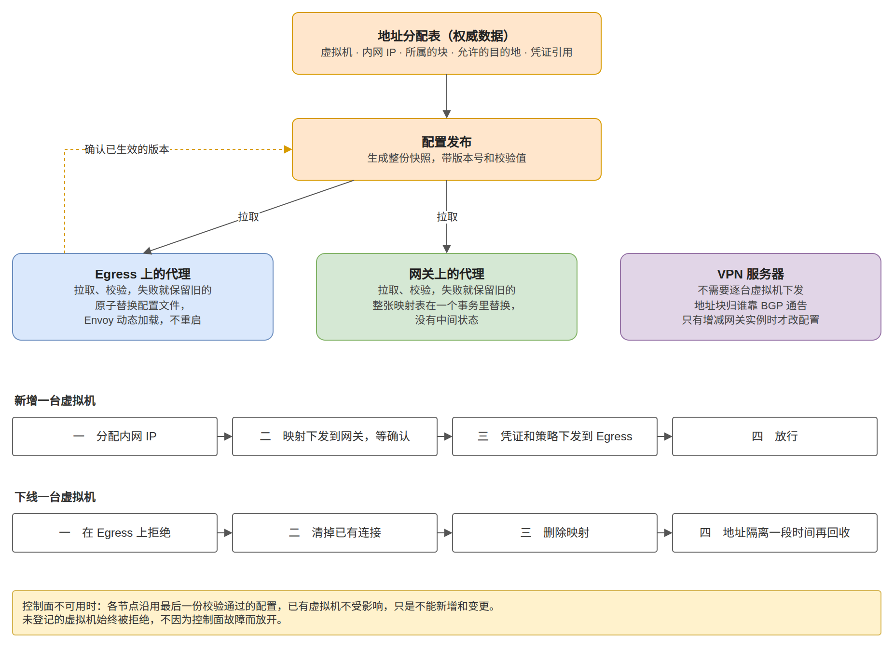

源图：[diagrams/10-control-plane.drawio](diagrams/10-control-plane.drawio)

### 一份权威数据

地址分配表是唯一的权威数据，其他节点上的东西都是从它生成的。表里的虚拟机清单和真实地址从云平台同步：虚拟机在云平台上，以平台的虚拟机元数据为准（2026-11-21 确认）。同步时由控制面通过平台的接口读取，只采用虚拟机自己改不了的那部分元数据，不采用虚拟机自己上报的内容。

表里的字段：

| 字段 | 用途 |
| --- | --- |
| 虚拟机真实 IP | 身份 |
| 内网 IP | 地址转换；内网服务按它限定凭证的来源 |
| 所属的地址块 | 决定归哪台 Egress、哪个网关单元 |
| 允许访问的内网目的地 | Egress 上的授权 |
| 凭证引用 | 这台虚拟机在各个服务上用哪份凭证；凭证本身在凭证库里 |
| 状态 | 已分配、已放行、已阻断、已下线、地址隔离中（等待回收） |

### 发布和生效

- **发布的是整份快照。** 带版本号和校验值。节点拿到的要么是完整的新版本，要么还是旧版本。
- **节点自己来拉。** 每台节点上有一个代理，定期或者被通知后去拉新版本。不可达的节点恢复之后会自己追上，不需要有人记着补发。
- **校验通过才替换，失败就保留旧的。**
- **替换是原子的。**
  - 网关的映射表：把“清空”和“写入全部记录”放在同一个 nftables 事务里执行，中间不存在表为空的时刻。实验结果：下发脚本已经改成这样（[`lab/eve-ng/files/load-map.sh`](../lab/eve-ng/files/load-map.sh)），十万条整表替换 0.57 秒；在承载流量的网关上连续替换 6 次，期间每秒 500 个请求，失败 0 个，身份不符 0 个。数据面 B 下 Egress 上同样的表是 0.52 到 0.74 秒。
  - Egress 的配置：用 Envoy 的文件动态配置。代理把新文件写好后用重命名替换旧文件，Envoy 发现后加载，不重启进程。有变化的部分怎么影响已有连接，要在实验里确认。
- **节点回报自己生效的版本。** 控制面据此知道一次变更有没有到齐。

网关上原子替换映射表的写法（示意）：

```
# 整个文件在一个事务里执行
flush map ip vpngw vm2intra
add element ip vpngw vm2intra { 10.1.2.3 : 100.64.0.7, 10.1.2.4 : 100.64.0.8 }
```

**VPN 服务器不需要逐台虚拟机下发。** 它只认地址块，块归谁靠 BGP 通告。只有增减网关实例时才需要改它的配置。唯一的例外是阻断：被阻断的虚拟机的内网 IP 会进它的拒绝名单，见下面的“逐台阻断”。

### 变更的顺序

新增一台虚拟机时，后面的环节先就绪，最后才放行；下线时反过来，先拦住入口。

| 新增 | 下线 |
| --- | --- |
| 一、分配内网 IP | 一、在 Egress 上拒绝这台虚拟机 |
| 二、映射下发到做地址转换的节点，等它们确认 | 二、清掉它已有的连接 |
| 三、凭证和策略下发到 Egress，等确认 | 三、删除映射 |
| 四、放行 | 四、内网 IP 隔离一段时间再回收 |

第四步的隔离是为了防止地址马上分给另一台虚拟机时，内网服务上还留着按旧主人放行的连接或缓存。

### 逐台阻断：不靠逐台隧道

**要求：** 发现一台虚拟机有违规行为时，管理员一个操作就能断开它对内网资源的访问，已经建立的连接也要断。办公笔记本现在是每台一条隧道，在 VPN 管理控制台上断开那条隧道就能做到。

这个要求本方案要满足，但不通过逐台隧道来满足。依据是每台虚拟机有独立的内网 IP：把这台虚拟机在地址分配表里的状态改成“已阻断”，在三个位置同时生效。

| 位置 | 动作 | 作用 |
| --- | --- | --- |
| Egress | 拒绝这台虚拟机的新连接，重置它已有的连接 | 在入口拦住。可以只断内网，也可以连互联网一起断，或者只断某几个服务 |
| 做地址转换的节点（A 是网关，B 是 Egress） | 删掉它的映射，清掉它的连接跟踪记录 | Egress 上的规则即使没有生效，它的流量也换不出内网地址 |
| VPN 服务器 | 把它的内网 IP 放进拒绝名单，两个方向都丢弃 | 这一处不依赖 Egress 和网关。控制面不可用时，也可以直接在这里操作 |

阻断的变更走通知，不等节点定期来拉，目标是几秒之内三处都生效。恢复是反过来的操作，内网 IP 不变。具体写法、多久生效、已有连接是不是确实断了，都要在实验里确认（放在第 4 期）。

和逐台隧道比：

|  | 每台虚拟机一条隧道 | 本方案的逐台阻断 |
| --- | --- | --- |
| 操作入口 | VPN 管理控制台，和笔记本一样 | 本方案的控制面；VPN 服务器上的拒绝名单是第二个入口 |
| 粒度 | 整台，全部内网访问 | 整台，或者某几个服务，或者连互联网一起 |
| 已有连接 | 隧道断开后全部不通 | Egress 重置，VPN 服务器丢弃 |
| VPN 服务器靠什么认出一台虚拟机 | 它自己的密钥 | 内网 IP。地址有没有被冒用，要靠网关和 Egress 保证 |
| 随虚拟机数量增长的东西 | 隧道、密钥、接口、服务器上的对端 | 映射表里的一条记录 |

逐台隧道有两种建法，都没有采用：

- **隧道建在虚拟机里**，也就是笔记本的做法、虚拟机迁移之前的做法。这正是基础方案要解决的问题：Egress 只看得到密文，注入不了凭证；隧道密钥放在虚拟机里，恶意进程拿得到，还能用它绕过 Egress。笔记本可以这么做，是因为笔记本上的密钥本来就交给使用它的人；虚拟机的前提是里面不放任何凭证。
- **隧道建在网关上，网关替每台虚拟机各建一条**，也就是基础方案选型表里的做法 B。它保留了 Egress 的处理，控制台上也能看到每台虚拟机，代价是：
  - WireGuard 的一个接口只有一对密钥，所以每台虚拟机要一个接口。十万台虚拟机就是网关上十万个接口和十万对密钥，VPN 服务器上十万个对端。
  - 网关成了集中存放全部虚拟机密钥的地方。
  - 高可用更难做。热备接管一个单元时，要把这个单元的隧道全部重新建起来。第 7 节让多台服务器同时工作，靠的是“每条邻接一个接口，用路由决定走哪条”；改成逐台隧道后，内网要知道每台虚拟机此刻挂在哪台服务器上，路由从几个地址块变成每台虚拟机一条。
  - 数据面 B 里“网关不保存状态”不再成立。
  - 断开的效果并没有更强。控制台断开的是网关替虚拟机建的那条隧道，虚拟机自己不持有密钥，这和删掉它的映射是一回事。

**结论（2026-11-21 确认）：采用逐台阻断，不做每台虚拟机一条隧道。** 真实的 VPN 服务器是自己搭的 WireGuard，拒绝名单可以做成现有管理控制台上的一个操作，对操作的人来说和断开一台笔记本是同一个动作。还要确认的是控制台能不能加这个功能，以及阻断要多快生效。

### 控制面故障时

各节点沿用最后一份校验通过的配置。已有的虚拟机不受影响，只是不能新增、下线和变更。未登记的虚拟机始终被拒绝，不因为控制面故障而放开。

阻断是例外，它不能等控制面恢复：VPN 服务器上的拒绝名单可以不经过控制面直接操作，事后再把状态补记回地址分配表。

节点重启之后，从本地保存的最后一份配置恢复，不依赖控制面在线。

### 分期

- **一期一个节点。** 目的是验证“下发不重启”“原子替换”“控制面停掉之后数据面不受影响”这三件事。一个节点证明不了控制面自身的高可用。
- **后续三个节点加一致性存储。** 同时可以用它的租约做归属仲裁（每个块同一时刻只有一个主用）。
- 实验里的控制面走管理网。生产里它要有独立的网络路径和访问控制。

## 10. 凭证的规模化

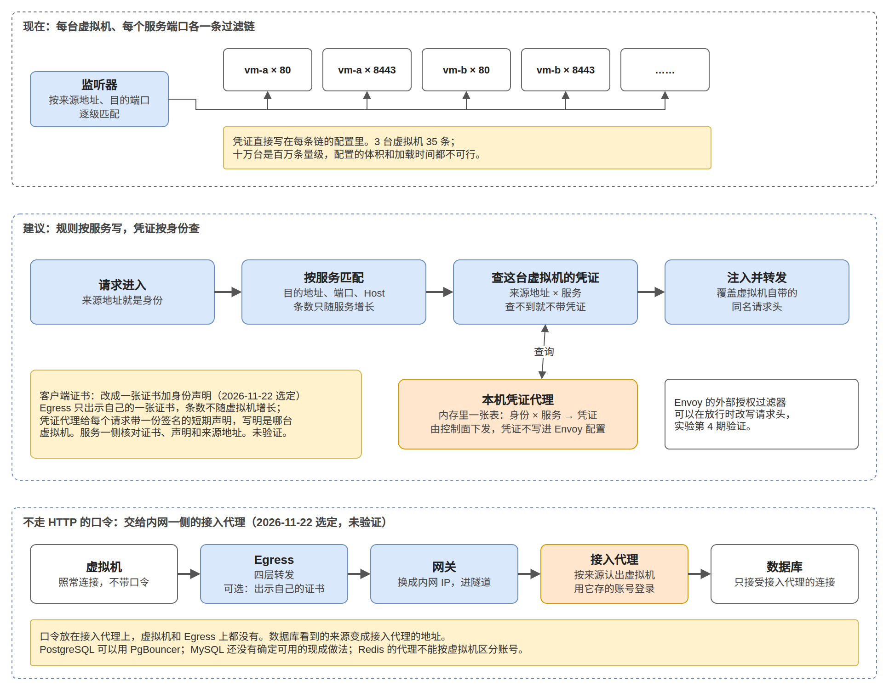

源图：[diagrams/11-credential-scale.drawio](diagrams/11-credential-scale.drawio)

### 请求头里的凭证：按身份查

现在的参考实现给每台虚拟机、每个服务端口生成一条过滤链，凭证直接写在配置里。3 台虚拟机 35 条，十万台就是百万条的量级，不可行。

改成两层：

- **规则按服务写。** “目的地址、端口、Host 是这个服务的请求，要带凭证”，一个服务一条规则。条数只随服务数量增长。
- **凭证按身份查。** 命中规则之后，用“来源地址 × 服务”去查这台虚拟机的凭证，查到就注入并覆盖虚拟机自带的同名请求头，查不到就不带凭证。

查的对象是 Egress 本机上的一个凭证代理：内存里一张表，由控制面下发。Envoy 的外部授权过滤器可以在放行请求的同时要求改写请求头，用它来接凭证代理。这样凭证不出现在 Envoy 的配置里，增减虚拟机也不用动 Envoy 的配置。

要验证和要决定的：

- 每个请求多一次本机查询，延迟增加多少。
- 凭证代理不可用时的行为。建议是指定服务的请求直接失败，不带凭证转发没有意义。
- 每台 Egress 只装它可能负责的块里的虚拟机的凭证，而不是全量。

### 客户端证书：改成一张证书加身份声明

Envoy 向上游发起 TLS 时用哪张客户端证书，是跟着上游集群配置的，不能按请求选。现在的参考实现给每台虚拟机单独建一个上游集群，同样不能扩展到十万台。

原来列了三个候选：

1. **按需创建上游。** 只为当前活跃的虚拟机创建它的上游集群，不活跃的回收。Envoy 支持按需发现上游集群，规模和回收的行为没有验证过。
2. **开发一个按身份选证书的扩展。** 工作量和维护成本最高。
3. **改变凭证的形式。** Egress 用自己的一张证书向服务发起 TLS，每个请求再带一个 Egress 签发的、短期有效的身份声明，说明它是替哪台虚拟机发的。这要内网服务配合改造。

**选定的方向（2026-11-22）：第三个。** 它也是业界出口网关的通行做法：网关用自己的身份访问外部服务，是谁发起的另外说明。对照见[和业界做法的对照](industry-comparison.md)第 3.2 和 3.6 节。**下面的机制全部没有在实验里验证过。**

做法：

- **一张证书。** Egress 向服务发起 TLS 时出示自己的证书，证明这条连接是 Egress 发起的。一个服务一个上游集群，条数不随虚拟机增长。
- **每个请求一份声明。** 请求头里带一份 Egress 签名的身份声明：是哪台虚拟机（内网 IP 和虚拟机标识）、发给哪个服务、什么时候过期。有效期按分钟算。
- **由凭证代理签发。** 命中上一小节的规则之后，凭证代理不再去查这台虚拟机的固定凭证，而是签一份声明。同一台虚拟机对同一个服务的声明在有效期内可以复用，不用每个请求签一次。虚拟机自带的同名请求头照旧被覆盖。
- **服务一侧校验三样。** 连接上的客户端证书是 Egress 的；声明的签名、受众、有效期都对；声明里的内网 IP 和这条连接的来源地址一致。三样都通过，才把声明里的虚拟机当作调用方。

它同时解决三个问题：

| 问题 | 现在 | 改了之后 |
| --- | --- | --- |
| 每台一张证书，扩不到几万台 | 每台虚拟机一个上游集群 | 一个服务一个上游集群 |
| 令牌被服务回显带回虚拟机 | 做不到拿不到，靠服务端按来源地址限定兜底 | 带回去的声明几分钟后过期；没有 Egress 的证书，也建不起服务认可的连接 |
| 多台共用的账号没法只作废一台 | 只能轮换 | 每台虚拟机的声明是分开的，停止给它签发就行 |

还有一点和网关有关。现在内网服务认虚拟机靠来源地址，来源地址是网关换上去的，所以网关被攻破等于整块地址被冒用。声明是 Egress 签的，网关和隧道只转发密文，改不了它。服务改成按声明认调用方之后，网关改了地址只会让校验失败，冒充不了别的虚拟机。

**服务一侧在哪里校验，两种放法：**

- **服务自己校验。** 要改服务。
- **在服务前面放一个校验代理。** 它要求客户端证书、校验声明，通过后把认出的调用方用一个请求头交给服务，服务只接受来自它的连接。据官方文档，Envoy 能做前两件事：监听器可以强制要求客户端证书；声明校验过滤器能查签名、签发者、受众和有效期，并把声明的内容交给后面的过滤器。其中签发者和受众要显式配置，不配就不查。“声明里的地址要等于连接的来源地址”没有现成的配置项，可能要用授权过滤器的条件表达式来写，官方没有这样的例子，要实测。

**简化形式：只用证书加来源地址，不带声明。** 服务能直接看到来源地址时，“Egress 的证书，加上这台虚拟机的内网 IP”已经能认出是谁，Egress 上不用加签发这一步。代价有两个：网关仍然在身份的信任链里；服务前面有负载均衡、看不到来源地址时用不了。不走 HTTP 的服务带不了请求头，只能用这种形式，见下一小节。

**适用范围。** 这个方向要内网服务配合：要么改服务，要么接受前面放校验代理。配合不了的服务维持现在的做法：客户端证书按虚拟机出示，令牌和静态凭证由 Egress 注入、服务端按来源地址限定。这部分的规模化仍然没有解决，候选一（按需创建上游）可以留作补充；候选二建议不再考虑。

**新出现的代价：**

- **多一层信任关系。** 内网服务要把 Egress 当作身份的签发方。这要服务的维护方接受。
- **Egress 上多一把签名密钥。** Egress 被攻破时能冒充任意虚拟机，这一点和现在一样，现在它存着所有虚拟机的凭证。不同的是泄露之后只要换一把密钥，不用轮换每台虚拟机的凭证。每台 Egress 用自己的密钥时，校验的一侧还可以查这台 Egress 有没有资格替这个地址块签，把影响限制在它负责的块里。
- **公钥要发到每个校验点。** 轮换时新旧要并存一段时间。走控制面下发。
- **每个请求多一次本机查询。** 和上一小节相同；签名本身的开销靠复用声明摊掉。

**要验证的：**

- 外部授权过滤器添加请求头、覆盖虚拟机自带的同名头。官方文档写明支持，没有在实验里试过。
- 签发和校验带来的延迟，对请求速率的影响；声明复用多久合适。
- 校验代理上“声明里的地址等于来源地址”怎么写。
- 对照：虚拟机拿到自己的声明之后，从虚拟机直接发、经 Egress 自带、从内网别的主机发，都应当被拒绝。
- 各节点时钟有偏差时，有效期的判断会不会出错。

### 不走 HTTP 的口令：交给内网一侧的接入代理

基础方案的结论是不走 HTTP 的口令注入不了，只能留在虚拟机里。原因是协议代理用的是自己的连接池，带不了虚拟机的身份。

数据面 B 去掉了 PROXY 头这个障碍，但没有自动解决这个问题：协议代理的上游连接仍然要以那台虚拟机的地址为源，而它的连接池不对应某一台虚拟机。要解决，需要协议代理能按“虚拟机 × 服务”把上游连接分开。现有的 Envoy 协议代理能不能做到没有验证过。

**选定的方向（2026-11-22）：口令不放在虚拟机里，也不放在 Egress 上，放到内网一侧、数据库前面的接入代理上，由它替虚拟机登录。** 这是业界数据库访问代理的做法，对照见[和业界做法的对照](industry-comparison.md)第 3.7 节。**下面的内容全部没有在实验里验证过。**

为什么换个位置就行：Egress 上的协议代理失败，是因为它的上游连接要穿过网关，而网关要靠每条连接开头的 PROXY 头才知道替谁换地址。接入代理在网关和隧道的后面，连接到它那里时，来源已经是这台虚拟机的内网 IP。它和数据库之间的连接不需要再带任何身份。

```
虚拟机 ──► Egress ──► 网关 ══ 隧道 ══► 接入代理 ──► 数据库
不带口令    四层转发    换成内网 IP       按来源认出虚拟机   用代理存的
                                         查它该用的账号     账号登录
```

- 虚拟机照常用数据库协议连接，不带口令。
- Egress 和网关不变，仍然是四层转发加地址转换。
- 接入代理按来源地址认出虚拟机，查它在这个库上该用哪个账号，替它登录。
- 数据库只接受接入代理的连接。

**连到接入代理的这一段，两种做法：**

| | 只按来源地址 | 再加 Egress 的证书 |
| --- | --- | --- |
| Egress 的改动 | 没有 | 在四层向接入代理发起 TLS，出示 Egress 的证书 |
| 靠什么认出虚拟机 | 来源地址 | 来源地址；证书另外证明连接经过了 Egress |
| 内网里的这一段 | 明文，和现在不走 TLS 的数据库连接一样 | 密文 |
| 前提 | 内网里别的主机冒用不了这些地址 | 协议允许一上来就做 TLS，见下表 |

第二种就是基础方案里验证过的“Egress 在四层代为握手”（实验的 6380 端口，最小实现），只是出示的证书从每台虚拟机一张换成 Egress 自己的一张，也就是上一小节的简化形式。

**各种协议能用什么。** 下表依据官方文档（2026-11-22 查阅），都没有在实验里试过：

| 协议 | 候选的接入代理 | 能不能替客户端登录 | 能不能一上来就做 TLS | 没有解决的 |
| --- | --- | --- | --- | --- |
| PostgreSQL | PgBouncer | 能。准入规则可以按来源地址写；连后端用的账号和口令在它自己的配置里，客户端不用知道 | 客户端一侧从 1.25.0 起支持 | 每台虚拟机一个账号时，准入规则是每台一行，几万行时加载和更新要多久没有查。它的文档里没有接收 PROXY 协议的功能，前面再垫一层代理它就看不到来源地址了 |
| MySQL | ProxySQL | 不确定。“客户端用一套账号、连后端用另一套”能不能做到，官方文档前后说法不一 | 不能。MySQL 协议总是服务端先发明文的握手包，之后才升级到 TLS | 要用证书的话，前面得再放一层只做 TLS 的代理，再把来源地址传给后面。ProxySQL 能接收 PROXY 协议（第一版） |
| Redis | Envoy 的 Redis 代理 | 能。配了上游口令后，它连上游时自己登录 | 能，由监听器做 | 口令跟着上游集群配置，不能按虚拟机区分账号 |
| 多种数据库 | 商业的数据库访问代理，例如 Teleport | 能 | — | 它们按自己签发的证书认客户端，要用配套的客户端或本地代理。让 Egress 直接接上去不是文档写明支持的用法 |

**新出现的代价：**

- **多一个组件，放在内网一侧，存着数据库的口令。** 它要按存放凭证的设备来保护。谁来部署和运维要定：算作产品的一部分，还是由内网的维护方提供。
- **数据库看到的来源变成接入代理的地址。** 按虚拟机的来源限定和审计都挪到接入代理上；数据库上按 IP 做的访问控制要改成只放行接入代理。
- **又一份按虚拟机维护的数据。** 接入代理要有“内网 IP 对账号”的对应关系，新增和下线虚拟机时要和地址分配表一起改。多台虚拟机共用一个账号时可以按地址块写，条数少得多。
- **接入代理自身的高可用。** 这类代理有连接状态，切换时连接会断。
- **拿不到不等于用不了。** 虚拟机被攻破后仍然能经这条路使用数据库，和 HTTP 的凭证一样。

**要验证的：**

- 真的 PostgreSQL 加 PgBouncer：虚拟机不带口令能登录；别的虚拟机用它的账号名被拒绝；内网里别的主机直连数据库被拒绝。
- MySQL：ProxySQL 能不能做到客户端不带真实的口令。做不到的话 MySQL 没有可用的现成做法。
- 两种接入做法各跑一遍；带证书的那种，Egress 发起的 TLS 能不能被 PgBouncer 接受。
- 接入代理故障和重启时，连接怎么样、多久恢复。

在验证之前，这类服务仍然列为例外：口令留在虚拟机里，靠服务端按来源地址限定来兜底。

## 11. 安全控制点的变化

基础方案的信任链不变：VPN 服务器信任网关，网关信任 Egress，Egress 识别虚拟机。规模上去之后，每一环的控制点要从“写死一个地址”变成“由控制面维护的一组”。

| 控制点 | 现在 | 规模化之后 |
| --- | --- | --- |
| 来源识别 | 依赖源地址，防伪造未验证 | 虚拟机接入的端口上校验源地址；接入路由器上做反向路径检查 |
| 网关的入口（A） | 15001 端口只接受一台 Egress 的地址 | 接受的是 Egress 实例的地址集合，由控制面维护，实例增减时同步更新 |
| 网关的入口（B） | — | 按来源限制源地址：每台 Egress 只能用它负责的块 |
| Egress 拒绝虚拟机访问基础设施网段 | 只拦了网关所在的网段 | 拦全部基础设施网段：接入、网关、内网核心、控制面 |
| VPN 服务器的来源检查 | 一个对端，一个 `/22` | 每个接口的 `AllowedIPs` 是那台网关可能承载的全部块 |
| 隧道密钥 | 主备两台共用一对 | 每台网关自己一对，可以单独吊销 |
| 未登记拦截 | 网关的映射表里没有就丢弃 | 不变；控制面故障时也不放开 |
| 逐台阻断 | 迁移前删掉这台虚拟机在 VPN 服务器上的对端；迁移后只能手工删映射 | 一个操作，在 Egress、做地址转换的节点、VPN 服务器三处生效，见第 9 节 |
| 配置的完整性 | 没有 | 下发的快照带校验；节点只接受校验通过的版本 |
| 审计 | 没有 | Egress 上每条连接、每个请求留记录 |

两个新出现的权衡：

- **热备共享得越广，单台网关被攻破的影响面越大。** 每台网关的 `AllowedIPs` 是它可能承载的全部块。所有网关互为热备时，任何一台都能以所有块的地址发包。可以把网关分组，热备只在组内共享。
- **B 把地址转换交给了 Egress，Egress 的权限变大了。** A 里 Egress 只能通过 PROXY 头“声明”身份，实际换地址的是网关，网关还能再检查一遍。B 里网关只能检查“这台 Egress 用的地址是不是在它负责的块里”，块内冒用拦不住。不过 A 里网关对 PROXY 头也是无条件信任的，所以两者在这一点上实际相当：Egress 被攻破，它负责的块里的身份都可以被冒用。

第 10 节 2026-11-22 选定的两个方向又带来两点变化，都没有验证过：

- **身份声明让内网服务多信任一方，少信任一方。** 多的是 Egress：服务要把它当作身份的签发方。少的是网关：服务按声明认调用方之后，网关改了来源地址只会让校验失败，冒充不了别的虚拟机。
- **内网一侧多了一个存口令的地方。** 数据库的接入代理存着它前面所有库的账号口令，按来源地址认虚拟机。它被攻破，这些库的口令全部泄露；内网里有主机能冒用虚拟机的内网 IP，就能借它登录。

## 12. 故障场景一览

下表是目标行为。标了“实验结果”的是在实验里用节点断电测过的，数字见[实验结果](ha-scale-results.md)；其余的都还要用故障注入确认。

| 故障 | 怎么发现 | 自动动作 | 已有连接 | 影响范围 |
| --- | --- | --- | --- | --- |
| 一台 Egress 断电 | VRRP 通告超时 | 接入地址漂到热备 | 这台 Egress 上的全部中断，重连后恢复。实验结果：新连接约 4.0 到 4.4 秒恢复，两种数据面一样 | 它负责的块。实验结果：另一个块 0 失败 |
| 一台网关断电（A） | VRRP 通告超时 | 服务地址漂到热备，热备承载这个单元 | 这个单元的全部中断。实验结果：单个单元的主备、两个单元加共享热备都是约 3.8 到 3.9 秒恢复，检测间隔调到 0.2 秒是 1.9 秒 | 这个单元的块。实验结果：另一个单元 0 失败 |
| 一台网关断电（B） | 目标是 BFD 超时；实验里是探测脚本，0.2 秒一次、连续 3 次没有应答 | 去程和回程的路由都撤掉这台 | 不断，检测期间丢包。实验结果：长连接全部存活，最长卡 1.5 秒；新连接 0.9 到 1.0 秒恢复 | 没有 |
| 一条隧道不通，两端都活着 | 隧道里的 BFD 超时 | 撤掉这条邻接的路由 | 不断，检测期间丢包 | 没有 |
| 一台 VPN 服务器断电 | 网关和内网核心上的 BFD 超时 | 两个方向都改走另一台 | 不断，检测期间丢包 | 没有 |
| 网关的转发进程异常，节点还在（A） | 健康检查 | 让出主用，同断电 | 这个单元的全部中断 | 这个单元的块 |
| 控制面不可用 | — | 不需要动作 | 不受影响 | 不能新增、下线、变更 |
| 主备之间的网络断开（A） | 不能自动发现 | 没有 | 这个单元的连接大面积失败，直到人工处理或仲裁介入 | 这个单元的块 |

最后一行是目前设计里没有解决的问题，见第 6 节“谁是主用”。

## 13. 实验环境改造

### 目标拓扑

在原来的九个节点上加八个，一共十七个。其中第 1 期的四个（`vm-farm`、`rtr-acc`、`egress-2`、`gw-3`）已经加上，实验现在是十三个节点；其余四个还没有加。

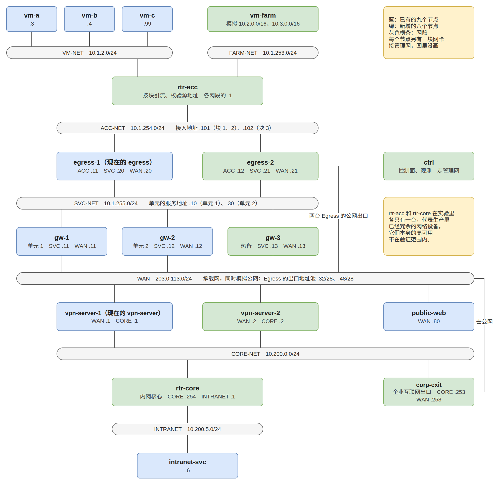

源图：[diagrams/12-lab-topology.drawio](diagrams/12-lab-topology.drawio)

新增的节点：

| 节点 | 角色 | 哪一期加 |
| --- | --- | --- |
| `vm-farm` | 模拟大量虚拟机，发压测流量 | 第 1 期 |
| `rtr-acc` | 接入路由器：按块引流，反向路径检查 | 第 1 期 |
| `egress-2` | 第二台 Egress | 第 1 期 |
| `gw-3` | 第三台网关，共享热备 | 第 1 期 |
| `vpn-server-2` | 第二台 VPN 服务器 | 第 2 期 |
| `rtr-core` | 内网核心路由器：对每个块有多条等价路由 | 第 2 期 |
| `ctrl` | 控制面、指标和日志的汇集 | 第 4 期 |
| `corp-exit` | 模拟企业的互联网出口：对虚拟机的内网 IP 做地址转换后发往公网，并记录日志 | 第 5 期 |

现有的 `egress` 和 `vpn-server` 改名为 `egress-1`、`vpn-server-1`（前一个已经改了，后一个等第 2 期）。`gw-2` 的角色从“单元 1 的备用”变成“单元 2 的主用”。

网段：

| 网段 | 地址 | 用途 | 状态 |
| --- | --- | --- | --- |
| VM-NET | `10.1.2.0/24` | 三台真实的虚拟机 | 已有，默认网关从 Egress 换成 `rtr-acc` |
| FARM-NET | `10.1.253.0/24` | `vm-farm` 到 `rtr-acc` | 新增 |
| ACC-NET | `10.1.254.0/24` | `rtr-acc` 到 Egress，各块的接入地址在这里 | 新增 |
| SVC-NET | `10.1.255.0/24` | Egress 到网关，各单元的服务地址在这里 | 已有 |
| WAN | `203.0.113.0/24` | 承载网，同时模拟公网 | 已有 |
| CORE-NET | `10.200.0.0/24` | VPN 服务器到 `rtr-core`；`corp-exit` 也接在这里，另一头接 WAN | 新增 |
| INTRANET | `10.200.5.0/24` | 内网服务 | 已有，默认网关从 VPN 服务器换成 `rtr-core` |

资源：十七个节点合计约 17 GB 内存，现有的实验主机够用。做性能测试时，Egress、网关、VPN 服务器要从 1 个 vCPU 加到 2 到 4 个，实验主机的核数最好相应增加。实际做法：这几类节点都加到了 2 核，实验主机没有动（12 核），压到最大时主机自身的 CPU 用到 70% 到 82%，节点之间会互相抢。

实验里两台路由器各只有一台，它们代表生产里已经冗余的网络设备，自身的高可用不在验证范围内。

### 怎么用少量节点模拟大量虚拟机

- **大量身份。** 在 `vm-farm` 上把一整段地址设成本机地址（一条本地路由覆盖整个网段），压测工具每条连接绑定不同的源地址。十万个身份只需要一个节点。
- **隔离和伪造。** 另外建几个网络命名空间，各自经网桥上的一个端口接出来，在网桥上按端口过滤源地址。用它们测“同网段冒用别人的地址”。
- **身份的规模和并发的规模分开测。** 十万个身份不等于十万台虚拟机同时在线。前者测的是映射表、凭证表的大小和更新时间；后者测的是连接数、吞吐和 CPU，受实验主机的资源限制。

### 分期

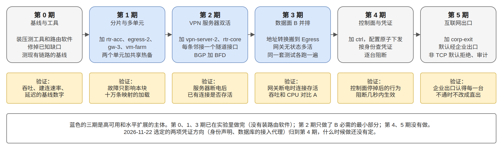

源图：[diagrams/13-roadmap.drawio](diagrams/13-roadmap.drawio)

| 期 | 做什么 | 验证什么 |
| --- | --- | --- |
| 0 基线与工具 | 节点上装压测工具和路由软件；修映射下发的空窗、连接跟踪表的上限；测现有链路 | 吞吐、建连速率、延迟的基线数字，后面各期和它比 |
| 1 分片与多单元（A） | 加四个节点；两台 Egress 按块分片、互为热备；两个网关单元加共享热备；加载十万条映射 | 一台 Egress 或网关断电只影响它负责的块；热备的接管时间；十万条映射的加载时间和内存；源地址冒用被拦住 |
| 2 VPN 服务器多活 | 加两个节点；每条邻接一个隧道接口；BGP 加 BFD；网关改成各自的密钥，接管改成通告地址块 | 一台服务器断电后已有连接不断、多久恢复；单条隧道不通时的行为；迁移并存重新验证 |
| 3 数据面 B | 块 3 改走 B：地址转换搬到 `egress-2`，网关对块 3 只转发 | 第 6 节列的五个验证点；同样的故障注入和压测，和 A 比 |
| 4 控制面与凭证 | 加 `ctrl`；节点代理拉取配置；Envoy 文件动态配置；按身份查凭证；逐台阻断；身份声明；数据库的接入代理 | 下发不重启、不断连接；控制面停掉后数据面的行为；配置的体积和更新时间不随虚拟机数增长；阻断一台虚拟机多久生效、已有连接断不断、别的虚拟机受不受影响；声明带回虚拟机后在别处用不了；虚拟机不带口令能登录数据库，别的来源被拒绝 |
| 5 互联网出口 | 出口地址池；非 TCP 默认拒绝；域名策略；访问日志；经企业出口的模式（加一个节点模拟企业的互联网出口） | UDP 绕行、伪造 SNI、解析到内网地址都被拦住；出口地址按虚拟机固定；日志完整；经企业出口时企业出口看到的来源是每台虚拟机的内网 IP，这条路断了不会自动改成直出 |

每一期都不破坏前面各期的验证：现有的阶段脚本（现状、迁移、主备切换、凭证）在每一期结束时都要能照常跑通。

第 10 节 2026-11-22 选定的两个方向归到第 4 期，什么时候做还没有定。它们不用加节点：在 Egress 上加签发声明的凭证代理，在内网服务的节点上加校验代理、真的 PostgreSQL 和 PgBouncer。现在实验里不走 HTTP 的服务只有一个 Redis 协议的最小实现。

第 3 期确定要做（2026-11-21）：实验里 A、B 都搭出来对比。B 能不能用到生产，仍然取决于真实 Egress 的维护方能不能接受它需要的改动。

**进度（2026-11-21）：第 0、1、3 期已经做完，结果在[实验结果](ha-scale-results.md)里；第 2、4、5 期没有做。** 现有的阶段脚本在改造后全部通过。已做的三期里，和上表不一样或者没做的有这些：

- 第 0 期没有装路由软件。这三期用探测脚本就够了，BGP 加 BFD 留给第 2 期。
- 第 1 期的“源地址冒用被拦住”只测了跨网段的，同网段内的冒用没有测。
- “主备之间的网络断开”“只阻断隧道的 UDP”“单方向丢包”这几种故障注入没有做，只做了节点断电和正常切换。
- 通过的标准没有写成数字。脚本判定的是“恢复了”“不受影响的块 0 失败”“身份不符 0”，中断时长只打印。
- 同时在线的规模没有测到十万台：十万个身份都发过请求，但并发的连接最多测到一万条（一个身份）和三万条左右的空闲连接。
- 数据面 B 下的凭证注入没有验证，走 B 的块上没有配凭证。

### 怎么证明

**度量：**

| 度量 | 怎么测 |
| --- | --- |
| 新连接多久恢复 | 持续地新建连接，记录最后一次成功到恢复后第一次成功之间的时间。现在的主备切换脚本就是这么测的 |
| 已有连接是否存活 | 一条持续传输、带序号的长连接，故障前后看它断没断、丢了多少 |
| 身份有没有串 | 每个请求让内网服务回报它看到的来源地址和认出的调用方，和期望的对照。这一项的错误数必须是 0 |
| 吞吐、建连速率、延迟 | 压测工具，记录各节点的 CPU 和软中断 |
| 配置的规模 | 配置体积、加载时间、内存占用随身份数量的变化 |

**故障注入：** 节点断电（用实验平台停止节点）、杀进程、只阻断隧道的 UDP、单方向丢包、主备之间的网络断开、控制面停掉、下发一份错误的配置。

**通过的标准要写成数字。** 现有的主备切换脚本只打印中断时长，不判定是否合格。第 0 期测出基线之后，给每一项定一个阈值，写进脚本。

### 这个实验证明不了什么

- 单台实验主机上的吞吐数字只能用来做相对比较（A 比 B、一台比两台），不能当成生产容量。
- 实验平台的虚拟网卡只有一个队列、没有内核加速，两种数据面的总吞吐都停在 2.3 到 2.6 Gbit/s 附近。所以“数据面 B 的吞吐随网关台数叠加到什么程度”在这台主机上测不出来。
- 实验主机自己的内核在一种压法下崩溃过两次：数据面 B 只留一台网关、压大流量，开始后四五分钟出事，原因没有查清。这一项的数字因此不完整，重跑时要避开，见[实验结果](ha-scale-results.md)第 9 节。
- 所有节点在同一台物理机上，证明不了跨物理机、跨机房的容灾。
- 实验里的 Egress 是参考实现。真实的 Egress 没有验证过。

## 14. 未验证的假设和待确认的事项

**依赖的 Envoy 行为，除了划掉的一条，都没有在 1.40.2 上验证过：**

- ~~去掉 PROXY 头之后，上游连接池是否仍然按源地址隔离。~~ 实验结果：隔离，见第 6 节的验证点 1。
- 文件动态配置更新时，对已有连接的影响。
- 外部授权过滤器改写请求头，接本机的凭证代理；用同一个机制带上身份声明。
- 声明校验过滤器加授权过滤器的条件表达式，比较声明里的地址和连接的来源地址。
- 按需创建上游集群，用于按身份选客户端证书。2026-11-22 起只作为配合不了的服务的补充。
- 按 SNI 动态转发。

**依赖的内核和路由行为。划掉的是这次有了实验结果的，其余没有验证过：**

- ~~连接跟踪分区能避开数据面 B 里的五元组冲突。~~ 实验结果：能，但放进单独分区的要是上游一侧，见第 6 节的验证点 2。
- BFD 在 WireGuard 接口上稳定工作，以及实际的恢复时间。
- 去程和回程走不同的网关或服务器时，沿途没有东西因为只看到一半的连接而丢包。实验结果：走不同的网关时不丢包，前提是网关上不跟踪这些连接。走不同的服务器、中间有按连接状态过滤的防火墙的情况没有测。
- ~~十万条记录的映射表，整表原子替换要多久。~~ 实验结果：0.57 秒，替换期间不影响流量。
- 阻断一台虚拟机时，删掉映射、清掉连接跟踪记录之后，它已有的连接是不是确实不通。

**要向人确认的：**

- [x] 目标规模是几万台虚拟机；切换时已有连接断开后重连，业务能接受（2026-11-21 确认）。
- [ ] 并发连接数和带宽的量级。互联网流量默认经隧道走企业出口，带宽要把它算进去。
- [x] 虚拟机的流量现在靠宿主机上的转发规则引到 Egress（2026-11-21 确认）。
- [ ] 宿主机上的转发规则由谁维护；能不能按子网指向不同的 Egress；接管时能不能在几秒内改掉指向；能不能在这一层校验源地址。
- [x] 虚拟机在云平台上，清单以平台的虚拟机元数据为准（2026-11-21 确认）。
- [ ] 是哪种云平台（公有云还是自建的私有云）；它支不支持地址漂移（VRRP 或高可用虚拟地址）；子网路由表的下一跳能不能通过接口修改。
- [x] 内网服务认的三类凭证大致各占三分之一（2026-11-21，粗略估计）。客户端证书和不走 HTTP 的口令都占不小的比例，所以“按身份选证书的规模化做法”和“口令的例外清单”都要当成正式的工作项，不能留到最后。
- [x] 虚拟机的真实地址按子网成段分配，可以直接按子网划块（2026-11-21 确认）。
- [ ] 存量虚拟机的内网 IP 是不是也成段，和真实地址的子网是否对得上。
- [ ] Egress 的维护方能不能接受数据面 B 需要的改动。要去问维护它的团队（2026-11-21），在得到答复之前 B 只在实验里验证。
- [x] 断开一台虚拟机用逐台阻断来做，不做每台一条隧道（2026-11-21 确认）。
- [x] 管理控制台是自己的工具，可以加“按内网 IP 拒绝”的功能；阻断在几秒内生效可以接受（2026-11-21 确认）。
- [x] 真实的 VPN 服务器是自己搭的 WireGuard，可以在上面配置隧道接口和路由；内网的路由设备可以和它跑动态路由（2026-11-21 确认）。
- [x] VPN 服务器和内网之间有按连接状态过滤的防火墙（2026-11-21 确认），影响见第 7 节。
- [ ] 这层防火墙是所有 VPN 服务器共用一套，还是每台服务器后面各有一套；真实的 VPN 服务器是否不做地址转换。
- [x] 互联网访问经企业出口：管控设备透明处理、不做 TLS 解密；企业出口会扩容；默认所有虚拟机经企业出口，保留一部分本地直出；这条路不通时不自动降级（2026-11-21 确认）。
- [x] “保留一部分本地直出”按虚拟机和按目的地两种分法都要（2026-11-21 确认）。
- [ ] 虚拟机有没有必须走 UDP 的互联网访问，现在不清楚。建议上线时先只记录不拒绝，观察一段时间，把确实需要的列出来放行，再切到默认拒绝。
- [x] 客户端证书的规模化改用一张证书加身份声明；不走 HTTP 的口令交给内网一侧的接入代理（2026-11-22 选定方向，见第 10 节）。
- [ ] 内网服务的维护方能不能接受把 Egress 当作身份的签发方；哪些服务能改、哪些能在前面放校验代理、哪些都不行。
- [ ] 内网服务前面有没有负载均衡。有的话服务看不到来源地址，只能用带声明的形式。
- [ ] 不走 HTTP 的服务各是什么协议、什么版本；账号是每台虚拟机一个，还是多台共用。
- [ ] 数据库的接入代理由谁部署和运维：算作产品的一部分，还是由内网的维护方提供。
- [ ] 基础方案里原有的待确认项仍然有效，见[那份文档的“前提、待确认事项与已知限制”](design.md#前提待确认事项与已知限制)。

**实验里新发现、还没有查清或解决的**（细节见[实验结果](ha-scale-results.md)第 9 节）：

- 数据面 B 下，Egress 的连接跟踪表丢了（清空、重启）之后，对端不会收到通知，内网服务上会留下关不掉的连接。数据面 A 的网关有同样的性质。
- 数据面 B 的回程规则去掉再放回去之后的头一两秒里，出现过一次请求被重置，之后没有再出现，原因没有证实。
- 数据面 B 里网关“按来源限制源地址”是按网卡地址认 Egress 的，同一个二层网段里可以伪造，没有测。
- Egress 上的反向路径检查打开之后，会不会拦数据面 B 的回程包，没有测。

**设计里还没有解决的：**

- 归属仲裁：主备之间的网络断开时怎么防止两台都当主用。
- 按身份选客户端证书的规模化做法。2026-11-22 选定改用一张证书加身份声明（第 10 节），未验证；配合不了的服务仍然没有解决。
- 不走 HTTP 的口令。2026-11-22 选定交给内网一侧的接入代理（第 10 节），未验证；MySQL 还没有确定可用的现成做法。
- 控制面自身的高可用（一期只有一个节点）。
